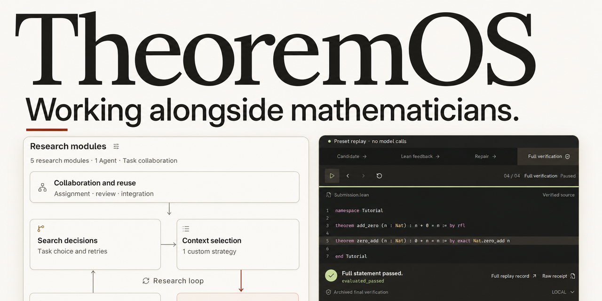
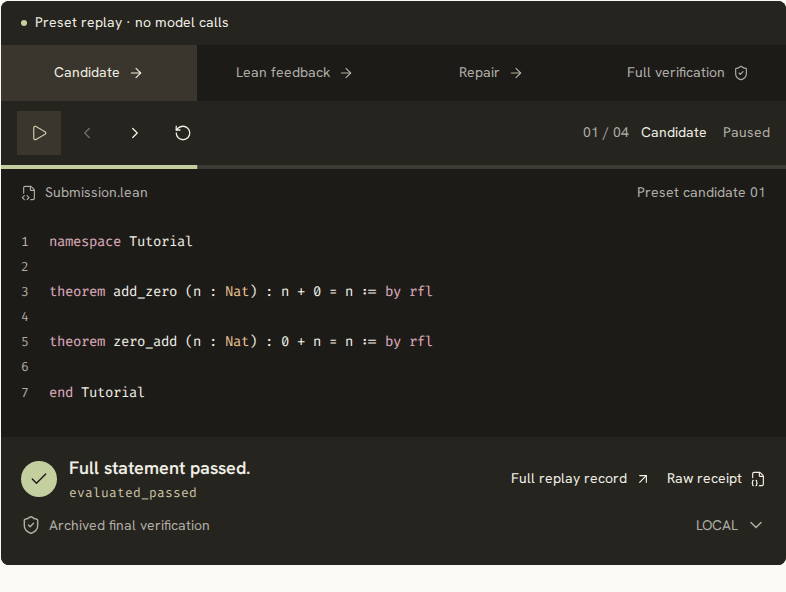
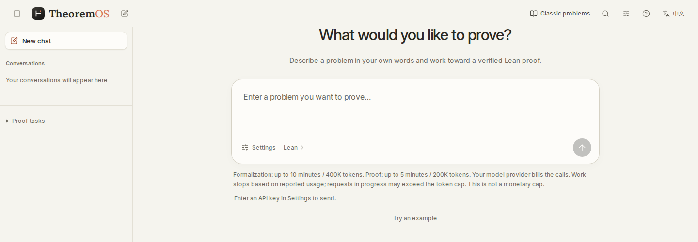

<strong>An AI Collaborative Research System and Formal Proof Platform for Frontier Mathematics</strong>

  <a href="https://theoremos.top/en/">🌐 Website</a> ·
  <a href="https://theoremos.top/en/#start"><strong>🚀 Request Early Access</strong></a> ·
  <a href="#core-innovations--system-design">Core Innovations</a> ·
  <a href="#how-it-supports-mathematical-research">Research Workflow</a> ·
  <a href="#featured-case-studies">Featured Cases</a> ·
  <a href="#research-collaboration">Collaboration</a> ·
  <a href="https://theoremos.top/en/archive.html">📜 Proof Archive</a> ·
  <a href="README.zh-CN.md">简体中文</a>

**TheoremOS is an AI collaborative research system built to work alongside mathematicians on challenging proofs.** You pose problems in natural language, TeX, or Lean 4, review formalized statements, and guide high-level strategy; within your compute budget, TheoremOS retrieves results, decomposes lemmas, explores proofs, and verifies every complete proof with an independent Lean checker. Start directly in the browser via the zero-setup [Cloud Workbench](https://app.theoremos.top/) or see the [Access Guide](docs/ACCESS.md) for preview onboarding and CLI collaboration.

> **Research Preview**: The [Cloud Workbench](https://app.theoremos.top/) is in email-whitelisted preview (free platform access; bring your own Responses API key). Apply via [GitHub Issue](https://github.com/LikC1606/TheoremOS/issues/new?template=early-access.yml) or see [Access Guide](docs/ACCESS.md) for CLI and collaboration inquiries.

> 🏆 **Research Output & Benchmark Results**: This repository releases **26 challenging frontier mathematical proof records** generated by the system across algebraic number theory, Riemannian geometry, functional analysis, and statistical physics—including **[10 proofs officially accepted by Lean-Eval](#lean-eval-10-officially-accepted-proofs)** and **[16 OpenAI Math proof records verified by local Lean and statement checkers](#openai-math-16-verified-proof-records)**.

**Start here:** [Illustrated quick start](docs/GETTING-STARTED.md) · [Research case](docs/CASE-STUDY.md) · [Capabilities & availability](docs/CAPABILITIES.md) · [Evaluation data](docs/EVALUATION.md) · [Downloadable proof kit](proof-kits/dimitrov/README.md)

## Proof Walkthrough

*Preset 4-step Lean verification walkthrough (`n + 0 = n`) illustrating how the workbench inspects goals and checks proofs. This replay uses a built-in example without live model calls.*

<b>Cloud Workbench Screenshot</b>

<a href="https://theoremos.top/en/#start">
  <picture>
    <source media="(max-width: 640px)" srcset="assets/workbench-mobile-en.png">
    
  </picture>
</a>

Cloud Workbench Entry · <a href="assets/workbench-full-desktop-en.png">Click to view full-resolution workflow screenshot</a>

---

## Core Innovations & System Design

| Core Capability | Key Mechanism | Value for Mathematicians |
| --- | --- | --- |
| **1. Independent Reverse-Translation Statement Check** | A model without access to the original prompt translates compiled Lean statements back into math prose for side-by-side comparison. | Spots missing hypotheses or degenerate definitions before spending compute on a flawed formalization. |
| **2. Verify the Proof Route First, Then Prove Lemmas in Parallel** | Checks that the main theorem follows from candidate lemmas (treated as temporary assumptions) before proving those lemmas in parallel. | Validates high-level proof structure early and keeps multi-lemma exploration organized. |
| **3. Process Preservation & Verified Lemma Reuse** | Saves search branches and compiler diagnostics for pause/resume, and re-verifies indexed lemmas in the target Lean environment when reused. | Preserves debugging context and builds a reusable library of verified lemmas across problems. |
| **4. Modular Architecture for Controlled Experiments** | Decouples execution, verification, search scheduling, context management, and role assignment into swappable modules. | Enables controlled CLI ablations and systematic comparison of proof strategies. |

<b>Four Core Mechanisms in Detail</b>

* **🔄 Rigorous Statement Verification via Back-Translation**
  In formal mathematics, *stating the problem correctly* and *completing the proof* are two fundamentally distinct tasks. Given a natural-language or $\TeX$ manuscript, TheoremOS first plans the definitions, hypotheses, and conclusions before generating a Lean statement. Passing the Lean compiler does not immediately trigger proof search. Instead, the system runs a two-step verification process: **without access to the original problem, a translation model reads only the compiled Lean statement and its underlying definitions to translate them back into standard mathematical prose; a separate review model then compares the original problem, the Lean statement, and the back-translated prose item by item**, checking hypotheses, conclusions, and quantifier scopes. This process helps mathematicians quickly spot discrepancies between formal code and intended meaning, catching subtle semantic errors—such as omitted conditions or vacuously true definitions—at the very first stage of research.
* **🧩 Goal-Oriented Lemma Decomposition & Parallel Declaration Merging**
  For complex theorems, the system supports deep single-path derivation, multi-path parallel exploration, and specialized multi-role collaboration across planning, retrieval, proof writing, and review.
  * **High-Level Route Dry-Runs Assuming Lemmas Hold**: Each decomposed auxiliary lemma has its Lean type and dependencies fixed while retaining the full statement and hypotheses of the original theorem in its subtask context, helping the research stay focused on the main theorem. Before proving individual lemmas, the system can treat their types as temporary assumptions and use Lean to verify whether they logically suffice to imply the main theorem—validating the high-level proof architecture upfront.
  * **Declaration-Level Merging & Independent Final Audit**: Every branch submission is bound to a code snapshot and checked against expected types and allowed declaration modifications. Progress across parallel branches is merged at the Lean declaration level (handling concurrent edits to independent lemmas and clearly reporting any conflicts) and tested against the main goal. Once all lemmas are proven and assembled into a complete proof free of temporary assumptions, an independent Lean verifier (alongside the original statement comparator where applicable) performs the final audit.
* **🏛️ Transparent Research Records & Verified Knowledge Index**
  TheoremOS exposes the entire reasoning trajectory, logging attempted routes, compiler diagnostics, incomplete steps, and compute usage. Researchers can inspect bottlenecks to adjust course at any time, or checkpoint and resume tasks later. Furthermore, any theorem or auxiliary lemma that passes Lean verification can be explicitly indexed into the knowledge base—preserving its full type signature, hypotheses, source code, and environment metadata for structured retrieval. When invoked in a new problem, the lemma is re-verified within the active Lean environment before reuse.
* **⚙️ Modular Experimental Platform for Controlled Comparisons**
  Beneath the web workbench, TheoremOS decouples its runtime into five independent decision-making components (**execution, result verification, search scheduling, context management, and role assignment**), decoupled from the number of active agents. Without modifying the core runtime, AI for Math researchers can swap out individual policies via source-level interfaces and use the CLI to run controlled ablation studies under fixed problems, models, environments, and budgets.

---

## How It Supports Mathematical Research

Mathematicians can integrate TheoremOS into four key stages of their daily research workflow:

1. **Verifying Definitions & Formal Statements**: Submit natural-language problems, $\TeX$ manuscripts, or partial Lean files, and use the system's back-translation and automated comparison checks to rapidly calibrate formal definitions and hypotheses.
2. **Rapidly Validating High-Level Proof Intuition**: Propose a macroscopic proof skeleton or key intermediate steps; let the system formalize them as auxiliary lemmas and verify upfront that "lemmas $\implies$ main theorem" holds in Lean, testing whether your high-level strategy is viable.
3. **Diagnosing Bottlenecks & Injecting Human Intuition**: When automated exploration hits a wall, inspect the attempted branches and exact compiler errors; inject missing hypotheses, refine lemma statements, or adjust the decomposition strategy before handing execution back to the system.
4. **Accumulating Formal Assets for Your Research Group**: Index verified technical lemmas established during a project into a structured library, making them directly searchable and reusable for future problems in the same domain without reinventing the wheel.

---

> 🧭 **Toward a "Math 2.0" Collaborative Research Paradigm**: As Fields Medalist Terence Tao highlighted in his [*Math 2.0* blog post](https://terrytao.wordpress.com/2026/10/10/math-2-0/) and [Caltech public lecture slides](https://teorth.github.io/tao-web/slides/math-2-0-caltech-2026.pdf) (October 2026):
>
> *“The more sustainable ‘Math 2.0’ use of AI would be to strengthen all the ways in which human understanding interacts with mathematics.”* (Slides, p. 23)
>
> He further emphasizes that mathematical exploration must move *beyond problem-solving* (pp. 9, 16)—where intermediate progress and failed attempts carry genuine research value—and that building large-scale, high-quality formal libraries like Mathlib to connect isolated efforts into a continuously updated knowledge network is a core application of "Math 2.0" (p. 25). **TheoremOS is built directly around this vision: rather than acting as a black-box solver that only outputs final answers, we provide mathematicians with a reliable, sustainable research partner through rigorous statement alignment, transparent process records, and lemma-level knowledge accumulation.**

---

## Featured Case Studies

From classical geometric theorems to frontier models in statistical physics, TheoremOS has demonstrated reliable formal reasoning across multiple core areas of mathematics:

| Case Study | Core Mathematical Result | Source Code, Verification & Full Process |
| --- | --- | --- |
| **[Hopf–Rinow Theorem](accepted/hopf_rinow/)** | Rigorously proves the equivalence of geodesic completeness and metric completeness under the manifold hypotheses specified in the problem. | [Lean Proof](accepted/hopf_rinow/Submission.lean) · [🏅 Official Pass](https://github.com/leanprover/lean-eval-submissions/issues/2143#issuecomment-6215093969) |
| **[Spectrum of the Planar Anderson Operator](docs/CASE-STUDY.md)** | For `h > 0` and i.i.d. random potentials uniformly distributed on `[-h, h]`, proves that the almost-sure spectrum is `[-4-h, 4+h]`. | [Statement](data/proofs/openai_planar_anderson_spectrum/Challenge.lean) · [Proof](data/proofs/openai_planar_anderson_spectrum/Submission.lean) · [Verification](data/proofs/openai_planar_anderson_spectrum/verification.json) · [Process](data/proofs/openai_planar_anderson_spectrum/process.json) |
| **Supercritical Three-State Reconstruction on Trees** | Under the supercritical conditions given in the problem, proves that the reconstruction advantage on regular and Poisson trees converges to a strictly positive limit. | [Statement](data/proofs/openai_three_state_supercritical/Challenge.lean) · [Proof](data/proofs/openai_three_state_supercritical/Submission.lean) · [Verification](data/proofs/openai_three_state_supercritical/verification.json) · [Process](data/proofs/openai_three_state_supercritical/process.json) |
| **Winning Strategy for Snaky** | Against any legal response, rigorously proves that Maker completes a winning Snaky configuration within 35 moves while maintaining board legality. | [Statement](data/proofs/openai_snaky_conditional/Challenge.lean) · [Proof](data/proofs/openai_snaky_conditional/Submission.lean) · [Verification](data/proofs/openai_snaky_conditional/verification.json) · [Process](data/proofs/openai_snaky_conditional/process.json) |

👉 **[Click to view all 26 proofs and verification records](#proofs--verification-records)**.

---

## Research Collaboration

We warmly invite collaborations with mathematicians and AI for Math researchers across the following directions:

* **🎓 For Mathematicians**: Bring the problems you are currently tackling, preliminary proof sketches, or partial Lean formalizations. Using TheoremOS, we can work together to align definitions and hypotheses, explore multiple proof routes in parallel, identify missing auxiliary lemmas, and evaluate how existing results can be reused to accelerate your research.
* **🤖 For Mathematical Agent Researchers**: Collaborate with us on search strategies, context selection, and multi-agent coordination mechanisms. Because execution, result verification, search scheduling, context management, and role assignment are decoupled into replaceable modules backed by a full CLI evaluation suite, TheoremOS serves as a clean platform for running controlled ablations and measuring the true impact of individual decision components.

💌 **Contact**: For collaboration inquiries, please email **[liuzhenhao@westlake.edu.cn](mailto:liuzhenhao@westlake.edu.cn)**—feel free to include the problem source or Lean statement, approaches tried so far, and questions you would like to explore together. For public academic discussions and feature requests, please **[open a GitHub Issue](https://github.com/LikC1606/TheoremOS/issues/new)**.

---

## Early Access & Getting Started

TheoremOS is currently open for research early access via an email allowlist. **During the early access period, the TheoremOS platform itself is completely free**—users simply bring their own API key to cover underlying LLM inference costs and gain access to the full collaborative research system.

> 💡 **Browse Online Without an API Key**: If you would like to inspect how the system tackles challenging mathematical problems first, no API key is required—you can directly explore the **[Proof Archive](https://theoremos.top/en/archive.html)** or watch the **[Interactive Walkthrough](https://theoremos.top/en/#demo)**.

**Onboarding Workflow:**

1. **Request Access**: Submit a brief description of your research use case (optionally linking to public problems or Lean statements) via our **[GitHub Issue Early Access Request](https://github.com/LikC1606/TheoremOS/issues/new?template=early-access.yml)**, or email **[liuzhenhao@westlake.edu.cn](mailto:liuzhenhao@westlake.edu.cn)** directly. *(Security note: Please never include API keys or sensitive personal information in a public GitHub Issue.)*
2. **Confirm Allowlist Access**: Once approved, follow the reply instructions to confirm your login email. After your address is added to the allowlist, sign in to the cloud workbench at **[app.theoremos.top](https://app.theoremos.top/)** using a one-time email verification code.
3. **Connect Model Provider**: Connect OpenAI or any Responses API-compatible LLM endpoint, enter your own API key, select your reasoning models, and configure your formalization and proving budgets.
4. **Submit Tasks & Inspect Proofs**: Submit natural-language problems, $\TeX$ manuscripts, or existing Lean statements and partial proofs; review the aligned Lean statement online, monitor the live proof derivation trajectory and token usage, and download the Lean source files, verification reports, and audit bundles at any time.

---

## Documentation, Verification & Feedback

- **Illustrated Quick Start**: [First research task](docs/GETTING-STARTED.md) — Model settings, budgets, statement review, results, and downloads.
- **Research Case Study**: [The planar Anderson spectrum](docs/CASE-STUDY.md) — The mathematical proof route, recorded exploration, and verification evidence.
- **Access & Preview Guide**: [`docs/ACCESS.md`](docs/ACCESS.md) — How to apply for the Cloud Workbench whitelist, BYOK requirements, and CLI research collaboration.
- **Capabilities & Availability**: [Browser features, CLI research access, and planned work](docs/CAPABILITIES.md).
- **Evaluation Data & Methodology**: [Archive composition, selected-run observations, and downloadable JSON/CSV](docs/EVALUATION.md).
- **Downloadable Proof Kit**: [Dimitrov: frozen statement, proof, environment, verification scripts, and reports](proof-kits/dimitrov/README.md).
- **Proof Verification Guide**: [`docs/VERIFY.md`](docs/VERIFY.md) — Provides a Mathlib-free Lean starter check and step-by-step reproduction for the Dimitrov official frozen workspace, alongside the 26 public proof records (10 with official Lean-Eval pass records; 16 OpenAI Math records checked by our Lean verifier and problem comparators, with no official OpenAI confirmation yet).
- **Licensing & Citations**: [`LICENSE`](LICENSE), [`docs/PUBLIC-MATERIALS.md`](docs/PUBLIC-MATERIALS.md) (terms for public docs and proof archives), and [`CITATION.cff`](CITATION.cff).
- **Release History**: [`CHANGELOG.md`](CHANGELOG.md).
- **Feedback & Issues**: Submit early access requests, bug reports, feature requests, or general questions via [GitHub Issues](https://github.com/LikC1606/TheoremOS/issues/new/choose).

---

## Proofs & Verification Records

### Lean-Eval: 10 Officially Accepted Proofs

<b>📂 Click to expand: View all 10 proofs officially accepted by Lean-Eval</b>

| Proof Package | Area | Official Result |
| --- | --- | --- |
| [Unit conjecture: a nontrivial group-ring unit](accepted/annals_unit_conjecture/) | Algebra | [🏅 #1246 · pass](https://github.com/leanprover/lean-eval-submissions/issues/1246#issuecomment-5380977645) |
| [Rademacher type and Enflo type coincide](accepted/annals_rademacher_enflo_type/) | Functional analysis | [🏅 #2115 · pass](https://github.com/leanprover/lean-eval-submissions/issues/2115#issuecomment-6161355838) |
| [Equiangular lines with a fixed angle](accepted/annals_equiangular_lines_fixed_angle/) | Discrete geometry | [🏅 #2135 · pass](https://github.com/leanprover/lean-eval-submissions/issues/2135#issuecomment-6186332699) |
| [Fractional expectation thresholds](accepted/annals_fractional_expectation_thresholds/) | Probabilistic combinatorics | [🏅 #2141 · pass](https://github.com/leanprover/lean-eval-submissions/issues/2141#issuecomment-6197783762) |
| [Dimitrov's lower bound for algebraic integers](accepted/dimitrov/) | Algebraic number theory | [🏅 #2143 · pass](https://github.com/leanprover/lean-eval-submissions/issues/2143#issuecomment-6215093969) |
| [Hopf–Rinow theorem](accepted/hopf_rinow/) | Riemannian geometry | [🏅 #2143 · pass](https://github.com/leanprover/lean-eval-submissions/issues/2143#issuecomment-6215093969) |
| [Improved bounds for the sunflower lemma](submitted/annals_improved_bounds_sunflower_lemma/) | Combinatorics | [🏅 #2144 · pass](https://github.com/leanprover/lean-eval-submissions/issues/2144#issuecomment-6222767100) |
| [Lorentzian polynomials](submitted/annals_lorentzian_polynomials/) | Algebraic combinatorics | [🏅 #2144 · pass](https://github.com/leanprover/lean-eval-submissions/issues/2144#issuecomment-6222767100) |
| [The optimal paper Möbius band](submitted/annals_optimal_moebius/) | Geometry | [🏅 #2144 · pass](https://github.com/leanprover/lean-eval-submissions/issues/2144#issuecomment-6222767100) |
| [Algebraic integers: an upper bound for λ_SSS](submitted/annals_algebraic_integers/) | Algebraic number theory | [🏅 #2144 · pass](https://github.com/leanprover/lean-eval-submissions/issues/2144#issuecomment-6222767100) |

Model and provenance metadata are recorded in [accepted.json](accepted/accepted.json) and [submitted.json](submitted/submitted.json). The final four proofs were accepted together in [submission #2144](https://github.com/leanprover/lean-eval-submissions/issues/2144#issuecomment-6222767100), with source files stored under `submitted/`.

### OpenAI Math: 16 Verified Proof Records

The following 16 proof records have been rigorously checked by our independent Lean verifier and statement review pipeline (with full research trajectories publicly released); official evaluation results from OpenAI have not yet been confirmed.

<b>📂 Click to expand: View statements, Lean proofs, verification reports, and full research trajectories for all 16 records</b>

| Problem Record | Area | Statement and Proof | Verification and Process |
| --- | --- | --- | --- |
| Supercritical three-state reconstruction on regular and Poisson trees | Probability | [Statement](data/proofs/openai_three_state_supercritical/Challenge.lean) · [Proof](data/proofs/openai_three_state_supercritical/Submission.lean) | [Local pass](data/proofs/openai_three_state_supercritical/verification.json) · [Process](data/proofs/openai_three_state_supercritical/process.json) |
| Face correspondence under triangle expansion | Combinatorial optimization | [Statement](data/proofs/openai_triangle_face/Challenge.lean) · [Proof](data/proofs/openai_triangle_face/Submission.lean) | [Local pass](data/proofs/openai_triangle_face/verification.json) · [Process](data/proofs/openai_triangle_face/process.json) |
| Endpoint non-integrability for the Koebe map and its inverse | Complex analysis | [Statement](data/proofs/openai_brennan_sharp/Challenge.lean) · [Proof](data/proofs/openai_brennan_sharp/Submission.lean) | [Local pass](data/proofs/openai_brennan_sharp/verification.json) · [Process](data/proofs/openai_brennan_sharp/process.json) |
| Support results on numerical ranges and finite-dimensional compressions | Functional analysis | [Statement](data/proofs/openai_hilbert_crouzeix/Challenge.lean) · [Proof](data/proofs/openai_hilbert_crouzeix/Submission.lean) | [Local pass](data/proofs/openai_hilbert_crouzeix/verification.json) · [Process](data/proofs/openai_hilbert_crouzeix/process.json) |
| Almost-sure spectrum of the planar Anderson operator | Random operators | [Statement](data/proofs/openai_planar_anderson_spectrum/Challenge.lean) · [Proof](data/proofs/openai_planar_anderson_spectrum/Submission.lean) | [Local pass](data/proofs/openai_planar_anderson_spectrum/verification.json) · [Process](data/proofs/openai_planar_anderson_spectrum/process.json) |
| Finiteness of the Ising-perceptron variational value | Probability and statistical physics | [Statement](data/proofs/openai_ising_finiteness/Challenge.lean) · [Proof](data/proofs/openai_ising_finiteness/Submission.lean) | [Local pass](data/proofs/openai_ising_finiteness/verification.json) · [Process](data/proofs/openai_ising_finiteness/process.json) |
| Totient companion: the no-seed zero case | Number theory | [Statement](data/proofs/openai_totient_companion_zero/Challenge.lean) · [Proof](data/proofs/openai_totient_companion_zero/Submission.lean) | [Local pass](data/proofs/openai_totient_companion_zero/verification.json) · [Process](data/proofs/openai_totient_companion_zero/process.json) |
| Compactness of normalized Cartier chart retractions | Algebraic geometry and topology | [Statement](data/proofs/openai_cartier_chart_compactness_support/Challenge.lean) · [Proof](data/proofs/openai_cartier_chart_compactness_support/Submission.lean) | [Local pass](data/proofs/openai_cartier_chart_compactness_support/verification.json) · [Process](data/proofs/openai_cartier_chart_compactness_support/process.json) |
| A colored-graph criterion for finite congruence lattices | Universal algebra and lattice theory | [Statement](data/proofs/openai_finite_congruence_graph/Challenge.lean) · [Proof](data/proofs/openai_finite_congruence_graph/Submission.lean) | [Local pass](data/proofs/openai_finite_congruence_graph/verification.json) · [Process](data/proofs/openai_finite_congruence_graph/process.json) |
| Existence of the honeycomb free-energy limit | Probability and statistical physics | [Statement](data/proofs/openai_honeycomb_free_energy/Challenge.lean) · [Proof](data/proofs/openai_honeycomb_free_energy/Submission.lean) | [Local pass](data/proofs/openai_honeycomb_free_energy/verification.json) · [Process](data/proofs/openai_honeycomb_free_energy/process.json) |
| A seven-coloring of the Euclidean plane | Discrete geometry | [Statement](data/proofs/openai_plane_coloring/Challenge.lean) · [Proof](data/proofs/openai_plane_coloring/Submission.lean) | [Local pass](data/proofs/openai_plane_coloring/verification.json) · [Process](data/proofs/openai_plane_coloring/process.json) |
| A legal 35-move winning strategy for Snaky | Combinatorial games | [Statement](data/proofs/openai_snaky_conditional/Challenge.lean) · [Proof](data/proofs/openai_snaky_conditional/Submission.lean) | [Local pass](data/proofs/openai_snaky_conditional/verification.json) · [Process](data/proofs/openai_snaky_conditional/process.json) |
| Snaky certificate verification | Combinatorial games | [Statement](data/proofs/openai_snaky_certificate/Challenge.lean) · [Proof](data/proofs/openai_snaky_certificate/Submission.lean) | [Local pass](data/proofs/openai_snaky_certificate/verification.json) · [Process](data/proofs/openai_snaky_certificate/process.json) |
| Hadamard cube-fiber cancellation | Linear algebra | [Statement](data/proofs/openai_hadamard_cube_fiber/Challenge.lean) · [Proof](data/proofs/openai_hadamard_cube_fiber/Submission.lean) | [Local pass](data/proofs/openai_hadamard_cube_fiber/verification.json) · [Process](data/proofs/openai_hadamard_cube_fiber/process.json) |
| A three-dimensional complete normal local complex algebra | Commutative algebra | [Statement](data/proofs/openai_surface_cone_candidate_support/Challenge.lean) · [Proof](data/proofs/openai_surface_cone_candidate_support/Submission.lean) | [Local pass](data/proofs/openai_surface_cone_candidate_support/verification.json) · [Process](data/proofs/openai_surface_cone_candidate_support/process.json) |
| A finite counterexample to Truffet's procedure | Tropical optimization | [Statement](data/proofs/openai_truffet_counterexample/Challenge.lean) · [Proof](data/proofs/openai_truffet_counterexample/Submission.lean) | [Local pass](data/proofs/openai_truffet_counterexample/verification.json) · [Process](data/proofs/openai_truffet_counterexample/process.json) |

🔍 Visit the **[Interactive Proof Archive](https://theoremos.top/en/archive.html)** to visually inspect the full derivation and research process behind each completed proof.

---

## Repository Contents

This repository publishes the official website pages, formal proof source files, and research process records; the TheoremOS runtime source code is proprietary.

<b>📂 Directory Structure & Licensing</b>

| Path | Contents |
| --- | --- |
| [accepted/](accepted/) | Six proofs officially accepted by Lean-Eval and their provenance records |
| [submitted/](submitted/) | Four additional proofs officially accepted in submission #2144 |
| [data/proofs/](data/proofs/) | 16 OpenAI Math proof records, including problem statements, Lean proofs, verification reports, and research trajectories |
| [in-progress/](in-progress/) | Earlier Lean proof drafts, some incomplete and containing `sorry` |
| [data/catalog.json](data/catalog.json) | Proof archive catalog with links to progress logs and verification results |
| `index.html`, `archive.html`, `feedback.html`, `en/`, `assets/` | Website pages, English localization, and workbench screenshots |

All rights to the TheoremOS runtime are reserved. Third-party fonts and icons are distributed under their respective licenses in [assets/fonts/](assets/fonts/), [assets/licenses/](assets/licenses/), and [lucide-LICENSE.txt](lucide-LICENSE.txt).

