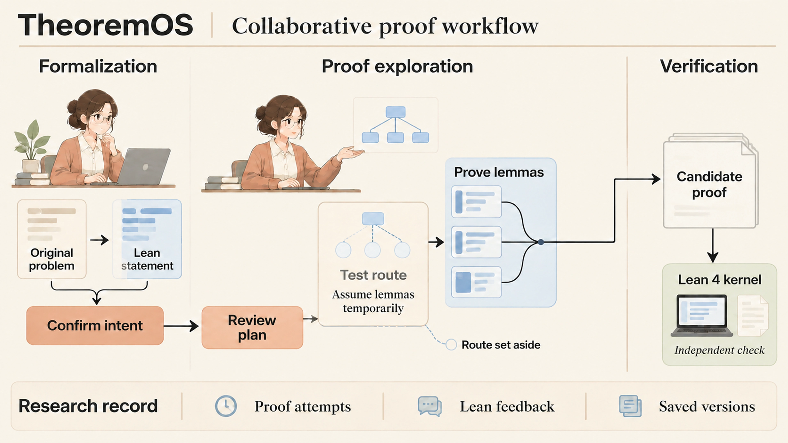

<!-- README_SYNC: source=16ba55670be597f22058a32c185727a047f63791; updated=2026-11-18 -->

English · <a href="./README.zh-CN.md" lang="zh-CN">简体中文</a>

# TheoremOS

Bring a mathematical problem to the TheoremOS workbench. Review its Lean 4 statement and guide the proof plan while TheoremOS looks for related results and explores possible lemmas. Completed candidates go through an independent Lean check.

[Star this repository](https://github.com/HuggingMath/TheoremOS) to find the public archive and verification kits again.

**Proof archive:** [English](https://theoremos.top/en/archive.html) · [简体中文](https://theoremos.top/archive.html)

**Workbench:** [Request research preview access](https://github.com/HuggingMath/TheoremOS/issues/new?template=early-access.yml) · [Sign in](https://app.theoremos.top/) · [Access guide](./docs/ACCESS.md)

This public repository contains the [website](https://theoremos.top/en/) ([中文](https://theoremos.top/)), proof records, and local verification materials. The workbench runs online. Runtime source and a public CLI installer are not included.

## Try TheoremOS

1. **Browse without an account.** Open the proof archive above for statements, Lean source, recorded attempts, and verification reports. The [planar Anderson spectrum case (EN)](./docs/CASE-STUDY.md) ([中文](./docs/CASE-STUDY.zh-CN.md)) walks through one example.
2. **Start a research task online.** Apply for email allowlist access and sign in with a verification code. Workbench access is free during the preview; you supply a model API key for a supported Responses API provider and pay that provider for inference. Set time and token limits before running. The [first-task guide (EN)](./docs/GETTING-STARTED.md) ([中文](./docs/GETTING-STARTED.zh-CN.md)) shows the workflow.
3. **Check a proof locally.** You need no TheoremOS account or model key. Start with the [Lean verification guide (EN)](./docs/VERIFY.md) ([中文](./docs/VERIFY.zh-CN.md)), or take the [Dimitrov proof kit (EN)](./proof-kits/dimitrov/README.md) ([中文](./proof-kits/dimitrov/README.zh-CN.md)) for a frozen benchmark workspace, proof, and comparator instructions.

Workbench screenshots: [English](./assets/workbench-desktop-en.png) · [简体中文](./assets/workbench-desktop.png). The preset Lean replay ([EN](./assets/proof-replay-en.gif) · [中文](./assets/proof-replay-zh.gif)) shows a candidate being checked, repaired, and accepted on a small example.

## How proof work is organized

- **Confirm the statement.** Submit natural language, TeX, or a single Lean file. Formalization produces a compilable statement, and a separate review compares it with the original. Compilation checks Lean syntax and types; the researcher still confirms mathematical intent.
- **Check a route before filling in the lemmas.** Temporarily assume candidate lemmas to check whether they imply the main goal. Prove the lemmas separately, then combine and check the completed proof without the temporary assumptions.
- **Inspect what was tried.** The workbench exposes available proof attempts and compiler feedback. Researchers can steer the plan and reuse verified lemmas, which are checked again in the target environment.
- **Run custom experiments through research collaboration.** The CLI is available by arrangement for multi-file projects and comparisons of execution, verification, scheduling, context, and role policies. See [capabilities and availability (EN)](./docs/CAPABILITIES.md) ([中文](./docs/CAPABILITIES.zh-CN.md)).

## Proof evidence

The [catalog](./data/catalog.json) lists 10 proofs with official Lean-Eval pass records, 18 OpenAI Math records checked with local Lean and problem comparators, and one in-progress record. The OpenAI Math records have no official OpenAI confirmation. Some records check a helper result or a conditional statement. The [evaluation notes (EN)](./docs/EVALUATION.md) ([中文](./docs/EVALUATION.zh-CN.md)) describe an earlier snapshot of selected runs; the archive does not establish a system-wide success rate or cost.

The source-by-source records below link to the criteria appropriate to each collection.

### Lean-Eval: 10 Officially Accepted Proofs

<b>View all 10 proofs officially accepted by Lean-Eval</b>

| Proof Package | Area | Official Result |
| --- | --- | --- |
| [Unit conjecture: a nontrivial group-ring unit](accepted/annals_unit_conjecture/) | Algebra | [#1246 · pass](https://github.com/leanprover/lean-eval-submissions/issues/1246#issuecomment-5380977645) |
| [Rademacher type and Enflo type coincide](accepted/annals_rademacher_enflo_type/) | Functional analysis | [#2115 · pass](https://github.com/leanprover/lean-eval-submissions/issues/2115#issuecomment-6161355838) |
| [Equiangular lines with a fixed angle](accepted/annals_equiangular_lines_fixed_angle/) | Discrete geometry | [#2135 · pass](https://github.com/leanprover/lean-eval-submissions/issues/2135#issuecomment-6186332699) |
| [Fractional expectation thresholds](accepted/annals_fractional_expectation_thresholds/) | Probabilistic combinatorics | [#2141 · pass](https://github.com/leanprover/lean-eval-submissions/issues/2141#issuecomment-6197783762) |
| [Dimitrov's lower bound for algebraic integers](accepted/dimitrov/) | Algebraic number theory | [#2143 · pass](https://github.com/leanprover/lean-eval-submissions/issues/2143#issuecomment-6215093969) |
| [Hopf–Rinow theorem](accepted/hopf_rinow/) | Riemannian geometry | [#2143 · pass](https://github.com/leanprover/lean-eval-submissions/issues/2143#issuecomment-6215093969) |
| [Improved bounds for the sunflower lemma](submitted/annals_improved_bounds_sunflower_lemma/) | Combinatorics | [#2144 · pass](https://github.com/leanprover/lean-eval-submissions/issues/2144#issuecomment-6222767100) |
| [Lorentzian polynomials](submitted/annals_lorentzian_polynomials/) | Algebraic combinatorics | [#2144 · pass](https://github.com/leanprover/lean-eval-submissions/issues/2144#issuecomment-6222767100) |
| [The optimal paper Möbius band](submitted/annals_optimal_moebius/) | Geometry | [#2144 · pass](https://github.com/leanprover/lean-eval-submissions/issues/2144#issuecomment-6222767100) |
| [Algebraic integers: an upper bound for λ_SSS](submitted/annals_algebraic_integers/) | Algebraic number theory | [#2144 · pass](https://github.com/leanprover/lean-eval-submissions/issues/2144#issuecomment-6222767100) |

Model and provenance metadata are recorded in [accepted.json](accepted/accepted.json) and [submitted.json](submitted/submitted.json). The final four proofs were accepted together in [submission #2144](https://github.com/leanprover/lean-eval-submissions/issues/2144#issuecomment-6222767100), with source files stored under `submitted/`.

### OpenAI Math: 18 locally verified records

These records link to the saved local Lean and problem-comparator checks. The all-seams entry covers a support result for the stated surface presentation.

<b>View statements, Lean proofs, verification reports, and full research trajectories for all 18 records</b>

| Problem Record | Area | Statement and Proof | Verification and Process |
| --- | --- | --- | --- |
| Supercritical three-state reconstruction on regular and Poisson trees | Probability | [Statement](data/proofs/openai_three_state_supercritical/Challenge.lean) · [Proof](data/proofs/openai_three_state_supercritical/Submission.lean) | [Local pass](data/proofs/openai_three_state_supercritical/verification.json) · [Process](data/proofs/openai_three_state_supercritical/process.json) |
| Face correspondence under triangle expansion | Combinatorial optimization | [Statement](data/proofs/openai_triangle_face/Challenge.lean) · [Proof](data/proofs/openai_triangle_face/Submission.lean) | [Local pass](data/proofs/openai_triangle_face/verification.json) · [Process](data/proofs/openai_triangle_face/process.json) |
| Endpoint non-integrability for the Koebe map and its inverse | Complex analysis | [Statement](data/proofs/openai_brennan_sharp/Challenge.lean) · [Proof](data/proofs/openai_brennan_sharp/Submission.lean) | [Local pass](data/proofs/openai_brennan_sharp/verification.json) · [Process](data/proofs/openai_brennan_sharp/process.json) |
| Support results on numerical ranges and finite-dimensional compressions | Functional analysis | [Statement](data/proofs/openai_hilbert_crouzeix/Challenge.lean) · [Proof](data/proofs/openai_hilbert_crouzeix/Submission.lean) | [Local pass](data/proofs/openai_hilbert_crouzeix/verification.json) · [Process](data/proofs/openai_hilbert_crouzeix/process.json) |
| Almost-sure spectrum of the planar Anderson operator | Random operators | [Statement](data/proofs/openai_planar_anderson_spectrum/Challenge.lean) · [Proof](data/proofs/openai_planar_anderson_spectrum/Submission.lean) | [Local pass](data/proofs/openai_planar_anderson_spectrum/verification.json) · [Process](data/proofs/openai_planar_anderson_spectrum/process.json) |
| Finiteness of the Ising-perceptron variational value | Probability and statistical physics | [Statement](data/proofs/openai_ising_finiteness/Challenge.lean) · [Proof](data/proofs/openai_ising_finiteness/Submission.lean) | [Local pass](data/proofs/openai_ising_finiteness/verification.json) · [Process](data/proofs/openai_ising_finiteness/process.json) |
| Totient companion: the no-seed zero case | Number theory | [Statement](data/proofs/openai_totient_companion_zero/Challenge.lean) · [Proof](data/proofs/openai_totient_companion_zero/Submission.lean) | [Local pass](data/proofs/openai_totient_companion_zero/verification.json) · [Process](data/proofs/openai_totient_companion_zero/process.json) |
| Compactness of normalized Cartier chart retractions | Algebraic geometry and topology | [Statement](data/proofs/openai_cartier_chart_compactness_support/Challenge.lean) · [Proof](data/proofs/openai_cartier_chart_compactness_support/Submission.lean) | [Local pass](data/proofs/openai_cartier_chart_compactness_support/verification.json) · [Process](data/proofs/openai_cartier_chart_compactness_support/process.json) |
| A colored-graph criterion for finite congruence lattices | Universal algebra and lattice theory | [Statement](data/proofs/openai_finite_congruence_graph/Challenge.lean) · [Proof](data/proofs/openai_finite_congruence_graph/Submission.lean) | [Local pass](data/proofs/openai_finite_congruence_graph/verification.json) · [Process](data/proofs/openai_finite_congruence_graph/process.json) |
| Existence of the honeycomb free-energy limit | Probability and statistical physics | [Statement](data/proofs/openai_honeycomb_free_energy/Challenge.lean) · [Proof](data/proofs/openai_honeycomb_free_energy/Submission.lean) | [Local pass](data/proofs/openai_honeycomb_free_energy/verification.json) · [Process](data/proofs/openai_honeycomb_free_energy/process.json) |
| A seven-coloring of the Euclidean plane | Discrete geometry | [Statement](data/proofs/openai_plane_coloring/Challenge.lean) · [Proof](data/proofs/openai_plane_coloring/Submission.lean) | [Local pass](data/proofs/openai_plane_coloring/verification.json) · [Process](data/proofs/openai_plane_coloring/process.json) |
| A legal 35-move winning strategy for Snaky | Combinatorial games | [Statement](data/proofs/openai_snaky_conditional/Challenge.lean) · [Proof](data/proofs/openai_snaky_conditional/Submission.lean) | [Local pass](data/proofs/openai_snaky_conditional/verification.json) · [Process](data/proofs/openai_snaky_conditional/process.json) |
| Snaky certificate verification | Combinatorial games | [Statement](data/proofs/openai_snaky_certificate/Challenge.lean) · [Proof](data/proofs/openai_snaky_certificate/Submission.lean) | [Local pass](data/proofs/openai_snaky_certificate/verification.json) · [Process](data/proofs/openai_snaky_certificate/process.json) |
| Hadamard cube-fiber cancellation | Linear algebra | [Statement](data/proofs/openai_hadamard_cube_fiber/Challenge.lean) · [Proof](data/proofs/openai_hadamard_cube_fiber/Submission.lean) | [Local pass](data/proofs/openai_hadamard_cube_fiber/verification.json) · [Process](data/proofs/openai_hadamard_cube_fiber/process.json) |
| A three-dimensional complete normal local complex algebra | Commutative algebra | [Statement](data/proofs/openai_surface_cone_candidate_support/Challenge.lean) · [Proof](data/proofs/openai_surface_cone_candidate_support/Submission.lean) | [Local pass](data/proofs/openai_surface_cone_candidate_support/verification.json) · [Process](data/proofs/openai_surface_cone_candidate_support/process.json) |
| A finite counterexample to Truffet's procedure | Tropical optimization | [Statement](data/proofs/openai_truffet_counterexample/Challenge.lean) · [Proof](data/proofs/openai_truffet_counterexample/Submission.lean) | [Local pass](data/proofs/openai_truffet_counterexample/verification.json) · [Process](data/proofs/openai_truffet_counterexample/process.json) |
| Supercritical reconstruction for three-state tree channels | Probability | [Statement](data/proofs/openai_three_state_tree_clauses/Challenge.lean) · [Proof](data/proofs/openai_three_state_tree_clauses/Submission.lean) | [Local pass](data/proofs/openai_three_state_tree_clauses/verification.json) · [Process](data/proofs/openai_three_state_tree_clauses/process.json) |
| Marked trace values across all surface seams (support result) | Algebraic geometry | [Statement](data/proofs/openai_character_varieties_all_seams_support/Challenge.lean) · [Proof](data/proofs/openai_character_varieties_all_seams_support/Submission.lean) | [Local pass](data/proofs/openai_character_varieties_all_seams_support/verification.json) · [Process](data/proofs/openai_character_varieties_all_seams_support/process.json) |

## Repository and reuse

| Path | What you can inspect |
| --- | --- |
| [accepted/](./accepted/) and [submitted/](./submitted/) | Lean-Eval proof packages and official result provenance |
| [data/proofs/](./data/proofs/) | OpenAI Math statements, proof files, local checks and saved process records |
| [in-progress/](./in-progress/) | Earlier drafts, some with unclosed `sorry` placeholders |
| [proof-kits/](./proof-kits/) and [examples/](./examples/) | A standalone benchmark kit and a short Lean example |
| [docs/](./docs/) and [CHANGELOG.md](./CHANGELOG.md) | Access, verification, evaluation and release information |

[LICENSE](./LICENSE) reserves rights to project-authored public materials. Archived proofs and third-party materials retain their own terms; see [Public materials, reuse, and citation](./docs/PUBLIC-MATERIALS.md). Cite the project through [CITATION.cff](./CITATION.cff) and cite the original sources of any proof you discuss.

For a multi-file Lean project, a custom toolchain, or a controlled CLI experiment, use the collaboration route in the [access guide](./docs/ACCESS.md). [Open an issue](https://github.com/HuggingMath/TheoremOS/issues/new/choose) for archive corrections or feedback, and [star the repository](https://github.com/HuggingMath/TheoremOS) to keep the verification resources handy.
