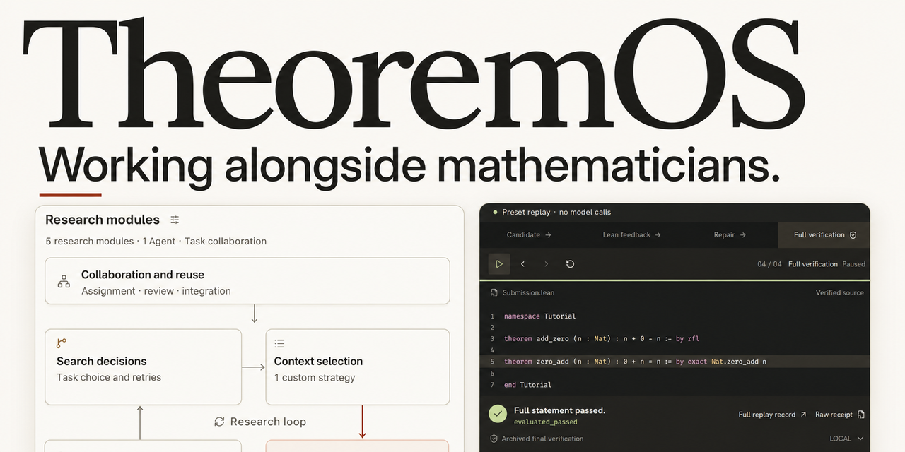
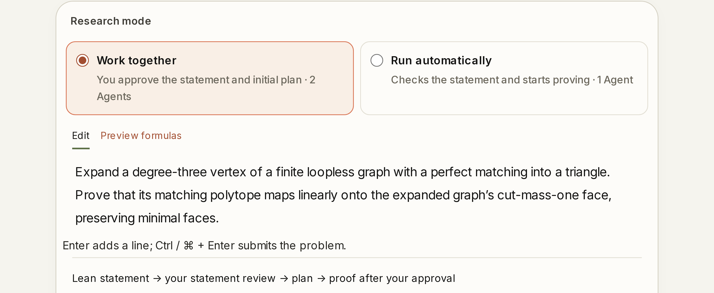
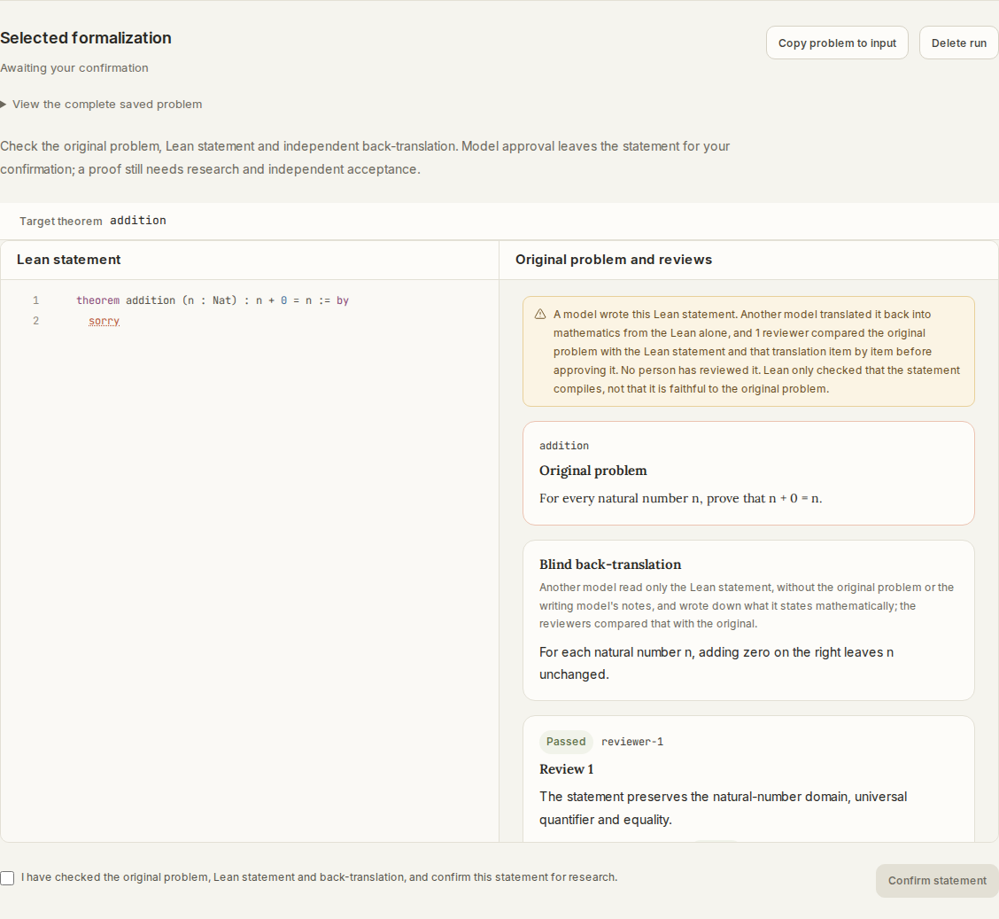
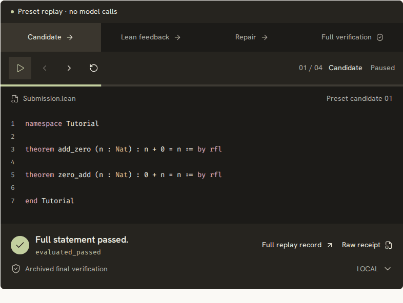
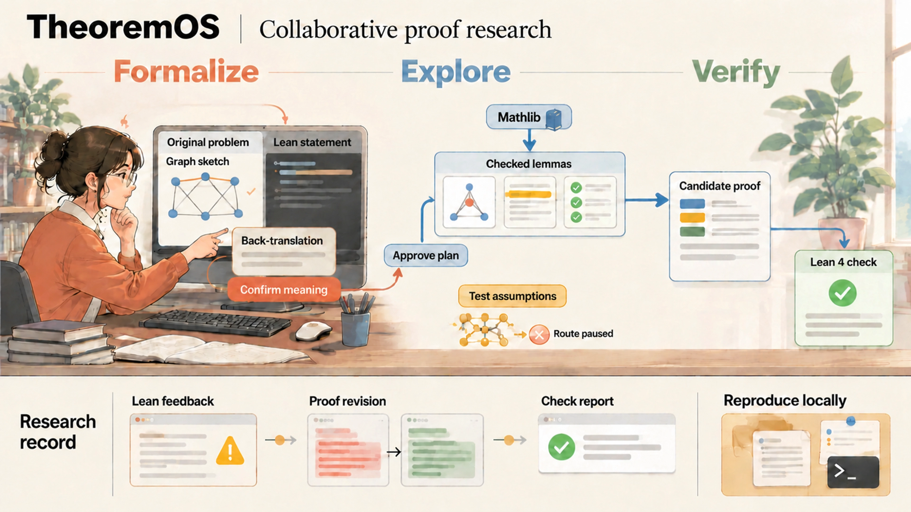
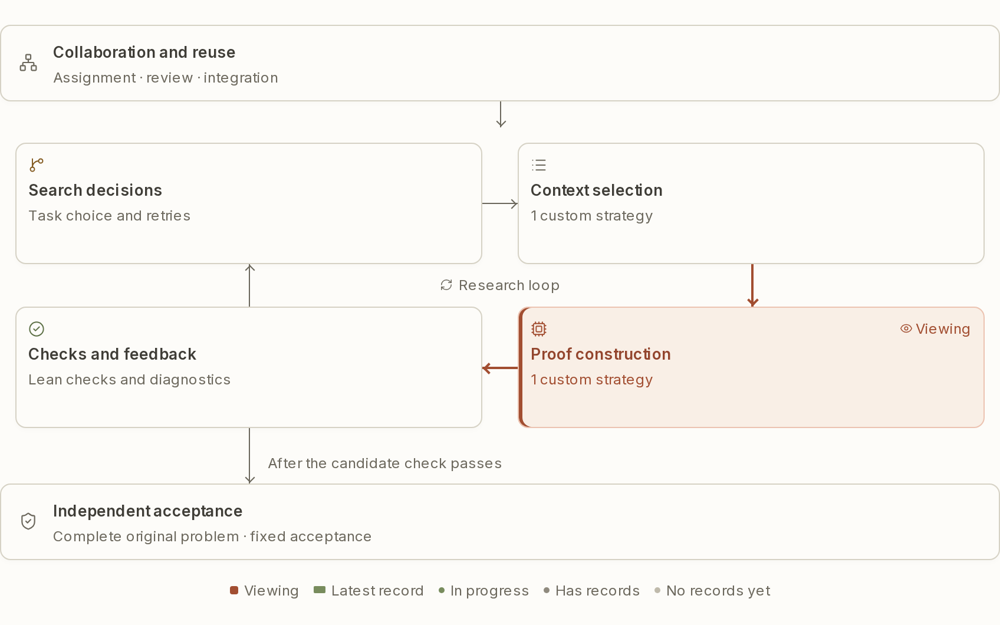

<!-- README_SYNC: source=16ba55670be597f22058a32c185727a047f63791; updated=2026-11-24 -->
<div align="center">
  <p>English · <a href="./README.zh-CN.md" lang="zh-CN">简体中文</a></p>
  <picture>
    <source media="(prefers-color-scheme: dark)" srcset="./assets/readme-mark-dark.svg">
    <source media="(prefers-color-scheme: light)" srcset="./assets/readme-mark.svg">
    
  </picture>
  <h1>TheoremOS</h1>
  <p><strong>Collaborative Lean 4 mathematical research — formalize statements, explore lemmas, and verify independently.</strong></p>
  <p>
    Developed at
    <a href="https://westlakenlp.com/"> <strong>WestlakeNLP</strong></a>
    (Natural Language Processing Lab, <a href="https://en.westlake.edu.cn/">Westlake University</a>)
  </p>
  <p>
    <a href="https://theoremos.top/en/">Website</a> ·
    <a href="https://theoremos.top/en/archive.html">Proof Archive</a> ·
    <a href="https://github.com/HuggingMath/theorem-os">Workbench &amp; CLI Source</a> ·
    <a href="./docs/ACCESS.md">Access Guide</a> ·
    <a href="./docs/VERIFY.md">Verify Locally</a> ·
    <a href="./CITATION.cff">Cite</a>
  </p>
  <p>
    <a href="https://github.com/HuggingMath/TheoremOS"></a>
    <a href="https://westlakenlp.com/"></a>
    <a href="./CHANGELOG.md"></a>
    <a href="./docs/VERIFY.md"></a>
    <a href="https://github.com/HuggingMath/theorem-os"></a>
    <a href="./LICENSE"></a>
  </p>
  <br>
  <a href="https://theoremos.top/en/">
    
  </a>
</div>

TheoremOS pairs mathematicians with AI research agents for formal proof construction: researchers define the problem, inspect generated Lean 4 statements, and steer lemma decomposition while the system handles Mathlib retrieval, parallel exploration, and independent Lean 4 kernel verification.

| Repository | Scope | License |
| --- | --- | --- |
| [HuggingMath/TheoremOS](https://github.com/HuggingMath/TheoremOS) | Product site ([theoremos.top](https://theoremos.top/en/)), 29 archived proof records, Dimitrov proof kit &amp; docs | [Rights reserved](./LICENSE) |
| [HuggingMath/theorem-os](https://github.com/HuggingMath/theorem-os) | Open-source web workbench, CLI runner (`bun run math`), and M1–M5 modules | [AGPL-3.0-only](https://github.com/HuggingMath/theorem-os/blob/main/LICENSE) |

---

## Quick Start

| What you want to do | Where to start | What you need |
| --- | --- | --- |
| **Browse verified proofs & trajectories** | [Proof Archive (EN)](https://theoremos.top/en/archive.html) · [中文档案](https://theoremos.top/archive.html) · [Case Study](./docs/CASE-STUDY.md) | Browser only (no account required) |
| **Verify a proof locally** | [Verification Guide](./docs/VERIFY.md) · [Dimitrov Proof Kit](./proof-kits/dimitrov/README.md) | Local Lean / Python / Git (no API key) |
| **Start an online research task** | [Request Access](https://github.com/HuggingMath/TheoremOS/issues/new?template=early-access.yml) · [Workbench](https://app.theoremos.top/) · [First-Task Guide](./docs/GETTING-STARTED.md) | Allowlisted email &amp; BYOK Responses API key |
| **Run locally or replace M1–M5 policies** | [HuggingMath/theorem-os](https://github.com/HuggingMath/theorem-os) · [Capabilities](./docs/CAPABILITIES.md) | Local TypeScript / Lean runtime (`AGPL-3.0-only`) |
| **Reuse an archived lemma** | [Proof Reuse Guide](./docs/PROOF-REUSE.md) | Local Lean 4 workspace |

<details>
<summary><b>Verify the preset Lean example locally in 3 commands (no Mathlib or API key needed)</b></summary>

```bash
git clone https://github.com/HuggingMath/TheoremOS.git && cd TheoremOS
elan toolchain install leanprover/lean4:v4.33.0
lean +leanprover/lean4:v4.33.0 examples/lean-check/Submission.lean
```

</details>

---

## Workbench & Verification Replay

<a href="./assets/workbench-desktop-en.png"></a>
<p align="center"><sub><strong>Step 1 · Problem Input &amp; Mode</strong> — Natural language, TeX, or single-file Lean input, collaborative or parallel mode, and budget controls (<a href="./assets/workbench-desktop.png">中文截图</a>).</sub></p>

<table width="100%">
  <tr>
    <td width="50%" align="center" valign="middle">
      <a href="./assets/guide/statement-review-en.png"></a>
    </td>
    <td width="50%" align="center" valign="middle">
      <a href="./assets/proof-replay-en.gif"></a>
    </td>
  </tr>
  <tr>
    <td width="50%" align="center" valign="top">
      <sub><strong>Step 2 · Statement Review</strong> — Compare the Lean 4 statement against blind back-translation before approving search (<a href="./assets/guide/statement-review-zh.png">中文截图</a>).</sub>
    </td>
    <td width="50%" align="center" valign="top">
      <sub><strong>Step 3 · Verification Replay</strong> — Four-step loop: candidate → Lean feedback → repair → independent kernel acceptance (<a href="./assets/proof-replay-zh.gif">中文回放</a>).</sub>
    </td>
  </tr>
</table>

---

## Collaborative Proof Workflow

1. **Statement Review** — Submit natural language, TeX, or an incomplete Lean file. Formalization generates a type-checked Lean statement alongside a semantic review comparison; the researcher confirms mathematical intent before proof search begins.
2. **Route & Lemma Decomposition** — Test whether candidate helper lemmas imply the main theorem before filling in all sub-proofs, then prove lemmas separately and assemble a `sorry`-free final proof.
3. **Trace Inspection & Lemma Reuse** — Inspect recorded proof attempts and compiler diagnostics, steer the plan interactively, and reuse verified lemmas (always re-checked in the target Lean environment).
4. **Open-Source CLI & Policy Experiments** — The workbench, CLI, and replaceable M1–M5 modules (construction, feedback, search, context, collaboration) are open source at [HuggingMath/theorem-os](https://github.com/HuggingMath/theorem-os). For custom Lake toolchains or joint evaluations, see [Capabilities & Collaboration (EN)](./docs/CAPABILITIES.md) ([中文](./docs/CAPABILITIES.zh-CN.md)).

<details>
<summary><b>View architecture diagram and end-to-end illustrated workflow</b></summary>
<br>
<table width="100%">
  <tr>
    <td width="50%" align="center" valign="middle">
      
    </td>
    <td width="50%" align="center" valign="middle">
      
    </td>
  </tr>
  <tr>
    <td width="50%" align="center" valign="top">
      <sub>End-to-end collaborative proving &amp; local reproduction</sub>
    </td>
    <td width="50%" align="center" valign="top">
      <sub>M1–M5 research loop separated from fixed S3 acceptance (<a href="./assets/workbench-modules-desktop.png">中文图</a>)</sub>
    </td>
  </tr>
</table>
</details>

---

## Proof Evidence

| Collection | Records | Verification Standard | Browse Files |
| --- | :---: | --- | --- |
| **Lean-Eval** | **10** | Official Lean-Eval pass records on frozen submission targets | [accepted/](./accepted/) · [submitted/](./submitted/) |
| **OpenAI Math** | **18** | Checked locally with Lean 4 and problem comparators *(no official OpenAI confirmation)* | [data/proofs/](./data/proofs/) |
| **In Progress** | **1** | Recorded intermediate draft snapshot | [in-progress/](./in-progress/) |

> [!NOTE]
> The [archive catalog](./data/catalog.json) contains 29 records in total. Some OpenAI Math entries check a supporting result or conditional statement, and the [evaluation notes (EN)](./docs/EVALUATION.md) ([中文](./docs/EVALUATION.zh-CN.md)) describe an earlier snapshot of selected runs rather than a system-wide pass rate or cost.

### Lean-Eval: 10 Officially Accepted Proofs

<details>
<summary><b>View all 10 proofs officially accepted by Lean-Eval</b></summary>

| Proof Package | Area | Official Result |
| --- | --- | --- |
| [Unit conjecture: a nontrivial group-ring unit](accepted/annals_unit_conjecture/) | Algebra | [#1246 · pass](https://github.com/leanprover/lean-eval-submissions/issues/1246#issuecomment-5380977645) |
| [Rademacher type and Enflo type coincide](accepted/annals_rademacher_enflo_type/) | Functional analysis | [#2115 · pass](https://github.com/leanprover/lean-eval-submissions/issues/2115#issuecomment-6161355838) |
| [Equiangular lines with a fixed angle](accepted/annals_equiangular_lines_fixed_angle/) | Discrete geometry | [#2135 · pass](https://github.com/leanprover/lean-eval-submissions/issues/2135#issuecomment-6186332699) |
| [Fractional expectation thresholds](accepted/annals_fractional_expectation_thresholds/) | Probabilistic combinatorics | [#2141 · pass](https://github.com/leanprover/lean-eval-submissions/issues/2141#issuecomment-6197783762) |
| [Dimitrov's lower bound for algebraic integers](accepted/dimitrov/) | Algebraic number theory | [#2143 · pass](https://github.com/leanprover/lean-eval-submissions/issues/2143#issuecomment-6215093969) |
| [Hopf–Rinow theorem](accepted/hopf_rinow/) | Riemannian geometry | [#2143 · pass](https://github.com/leanprover/lean-eval-submissions/issues/2143#issuecomment-6215093969) |
| [Improved bounds for the sunflower lemma](submitted/annals_improved_bounds_sunflower_lemma/) | Combinatorics | [#2144 · pass](https://github.com/leanprover/lean-eval-submissions/issues/2144#issuecomment-6222767100) |
| [Lorentzian polynomials](submitted/annals_lorentzian_polynomials/) | Algebraic combinatorics | [#2144 · pass](https://github.com/leanprover/lean-eval-submissions/issues/2144#issuecomment-6222767100) |
| [The optimal paper Möbius band](submitted/annals_optimal_moebius/) | Geometry | [#2144 · pass](https://github.com/leanprover/lean-eval-submissions/issues/2144#issuecomment-6222767100) |
| [Algebraic integers: an upper bound for λ_SSS](submitted/annals_algebraic_integers/) | Algebraic number theory | [#2144 · pass](https://github.com/leanprover/lean-eval-submissions/issues/2144#issuecomment-6222767100) |

Model and provenance metadata are recorded in [`accepted.json`](accepted/accepted.json) and [`submitted.json`](submitted/submitted.json). The final four proofs were accepted together in [submission #2144](https://github.com/leanprover/lean-eval-submissions/issues/2144#issuecomment-6222767100), with source files stored under [`submitted/`](submitted/).

</details>

### OpenAI Math: 18 Locally Verified Records

<details>
<summary><b>View statements, Lean proofs, verification reports, and research trajectories for all 18 records</b></summary>

| Problem Record | Area | Statement &amp; Proof | Verification &amp; Process |
| --- | --- | --- | --- |
| Supercritical three-state reconstruction on regular and Poisson trees | Probability | [Statement](data/proofs/openai_three_state_supercritical/Challenge.lean) · [Proof](data/proofs/openai_three_state_supercritical/Submission.lean) | [Local pass](data/proofs/openai_three_state_supercritical/verification.json) · [Process](data/proofs/openai_three_state_supercritical/process.json) |
| Face correspondence under triangle expansion | Combinatorial optimization | [Statement](data/proofs/openai_triangle_face/Challenge.lean) · [Proof](data/proofs/openai_triangle_face/Submission.lean) | [Local pass](data/proofs/openai_triangle_face/verification.json) · [Process](data/proofs/openai_triangle_face/process.json) |
| Endpoint non-integrability for the Koebe map and its inverse | Complex analysis | [Statement](data/proofs/openai_brennan_sharp/Challenge.lean) · [Proof](data/proofs/openai_brennan_sharp/Submission.lean) | [Local pass](data/proofs/openai_brennan_sharp/verification.json) · [Process](data/proofs/openai_brennan_sharp/process.json) |
| Support results on numerical ranges and finite-dimensional compressions | Functional analysis | [Statement](data/proofs/openai_hilbert_crouzeix/Challenge.lean) · [Proof](data/proofs/openai_hilbert_crouzeix/Submission.lean) | [Local pass](data/proofs/openai_hilbert_crouzeix/verification.json) · [Process](data/proofs/openai_hilbert_crouzeix/process.json) |
| Almost-sure spectrum of the planar Anderson operator | Random operators | [Statement](data/proofs/openai_planar_anderson_spectrum/Challenge.lean) · [Proof](data/proofs/openai_planar_anderson_spectrum/Submission.lean) | [Local pass](data/proofs/openai_planar_anderson_spectrum/verification.json) · [Process](data/proofs/openai_planar_anderson_spectrum/process.json) |
| Finiteness of the Ising-perceptron variational value | Probability and statistical physics | [Statement](data/proofs/openai_ising_finiteness/Challenge.lean) · [Proof](data/proofs/openai_ising_finiteness/Submission.lean) | [Local pass](data/proofs/openai_ising_finiteness/verification.json) · [Process](data/proofs/openai_ising_finiteness/process.json) |
| Totient companion: the no-seed zero case | Number theory | [Statement](data/proofs/openai_totient_companion_zero/Challenge.lean) · [Proof](data/proofs/openai_totient_companion_zero/Submission.lean) | [Local pass](data/proofs/openai_totient_companion_zero/verification.json) · [Process](data/proofs/openai_totient_companion_zero/process.json) |
| Compactness of normalized Cartier chart retractions | Algebraic geometry and topology | [Statement](data/proofs/openai_cartier_chart_compactness_support/Challenge.lean) · [Proof](data/proofs/openai_cartier_chart_compactness_support/Submission.lean) | [Local pass](data/proofs/openai_cartier_chart_compactness_support/verification.json) · [Process](data/proofs/openai_cartier_chart_compactness_support/process.json) |
| A colored-graph criterion for finite congruence lattices | Universal algebra and lattice theory | [Statement](data/proofs/openai_finite_congruence_graph/Challenge.lean) · [Proof](data/proofs/openai_finite_congruence_graph/Submission.lean) | [Local pass](data/proofs/openai_finite_congruence_graph/verification.json) · [Process](data/proofs/openai_finite_congruence_graph/process.json) |
| Existence of the honeycomb free-energy limit | Probability and statistical physics | [Statement](data/proofs/openai_honeycomb_free_energy/Challenge.lean) · [Proof](data/proofs/openai_honeycomb_free_energy/Submission.lean) | [Local pass](data/proofs/openai_honeycomb_free_energy/verification.json) · [Process](data/proofs/openai_honeycomb_free_energy/process.json) |
| A seven-coloring of the Euclidean plane | Discrete geometry | [Statement](data/proofs/openai_plane_coloring/Challenge.lean) · [Proof](data/proofs/openai_plane_coloring/Submission.lean) | [Local pass](data/proofs/openai_plane_coloring/verification.json) · [Process](data/proofs/openai_plane_coloring/process.json) |
| A legal 35-move winning strategy for Snaky | Combinatorial games | [Statement](data/proofs/openai_snaky_conditional/Challenge.lean) · [Proof](data/proofs/openai_snaky_conditional/Submission.lean) | [Local pass](data/proofs/openai_snaky_conditional/verification.json) · [Process](data/proofs/openai_snaky_conditional/process.json) |
| Snaky certificate verification | Combinatorial games | [Statement](data/proofs/openai_snaky_certificate/Challenge.lean) · [Proof](data/proofs/openai_snaky_certificate/Submission.lean) | [Local pass](data/proofs/openai_snaky_certificate/verification.json) · [Process](data/proofs/openai_snaky_certificate/process.json) |
| Hadamard cube-fiber cancellation | Linear algebra | [Statement](data/proofs/openai_hadamard_cube_fiber/Challenge.lean) · [Proof](data/proofs/openai_hadamard_cube_fiber/Submission.lean) | [Local pass](data/proofs/openai_hadamard_cube_fiber/verification.json) · [Process](data/proofs/openai_hadamard_cube_fiber/process.json) |
| A three-dimensional complete normal local complex algebra | Commutative algebra | [Statement](data/proofs/openai_surface_cone_candidate_support/Challenge.lean) · [Proof](data/proofs/openai_surface_cone_candidate_support/Submission.lean) | [Local pass](data/proofs/openai_surface_cone_candidate_support/verification.json) · [Process](data/proofs/openai_surface_cone_candidate_support/process.json) |
| A finite counterexample to Truffet's procedure | Tropical optimization | [Statement](data/proofs/openai_truffet_counterexample/Challenge.lean) · [Proof](data/proofs/openai_truffet_counterexample/Submission.lean) | [Local pass](data/proofs/openai_truffet_counterexample/verification.json) · [Process](data/proofs/openai_truffet_counterexample/process.json) |
| Supercritical reconstruction for three-state tree channels | Probability | [Statement](data/proofs/openai_three_state_tree_clauses/Challenge.lean) · [Proof](data/proofs/openai_three_state_tree_clauses/Submission.lean) | [Local pass](data/proofs/openai_three_state_tree_clauses/verification.json) · [Process](data/proofs/openai_three_state_tree_clauses/process.json) |
| Marked trace values across all surface seams (support result) | Algebraic geometry | [Statement](data/proofs/openai_character_varieties_all_seams_support/Challenge.lean) · [Proof](data/proofs/openai_character_varieties_all_seams_support/Submission.lean) | [Local pass](data/proofs/openai_character_varieties_all_seams_support/verification.json) · [Process](data/proofs/openai_character_varieties_all_seams_support/process.json) |

</details>

---

## Repository Structure

| Path | Contents |
| --- | --- |
| [accepted/](./accepted/) · [submitted/](./submitted/) | Lean-Eval proof packages and official submission provenance |
| [data/proofs/](./data/proofs/) | OpenAI Math problem statements, proof files, local checks, and saved trajectories |
| [in-progress/](./in-progress/) | Earlier drafts, some with unclosed `sorry` placeholders |
| [proof-kits/](./proof-kits/) · [examples/](./examples/) | Standalone Dimitrov benchmark verification kit and short Lean reuse examples |
| [docs/](./docs/) · [CHANGELOG.md](./CHANGELOG.md) | Access, verification, reuse, capability, evaluation, and release documentation |

---

## About WestlakeNLP

<table width="100%">
  <tr>
    <td width="124" align="center" valign="middle">
      <a href="https://westlakenlp.com/">
        
      </a>
    </td>
    <td valign="middle">
      TheoremOS is developed at <a href="https://westlakenlp.com/"><strong>WestlakeNLP</strong></a>, the Natural Language Processing Lab at <a href="https://en.westlake.edu.cn/">Westlake University</a> (founded in 2018 and led by <a href="https://en.westlake.edu.cn/faculty/nlp/yue-zhang.html">Prof. Yue Zhang</a>). The lab pursues fundamental and applied research in natural language processing, language-model reasoning, and AI for Science.
      <br><br>
      <strong>Website:</strong> <a href="https://westlakenlp.com/">westlakenlp.com</a> ·
      <strong>X (Twitter):</strong> <a href="https://x.com/NlpWestlake">@NlpWestlake</a> ·
      <strong>Contact:</strong> <a href="mailto:liuzhenhao@westlake.edu.cn">liuzhenhao@westlake.edu.cn</a>
    </td>
  </tr>
</table>

## License & Citation

[LICENSE](./LICENSE) reserves rights to project-authored public site and documentation materials in this repository, while [HuggingMath/theorem-os](https://github.com/HuggingMath/theorem-os) is licensed under `AGPL-3.0-only`. Archived proofs and third-party materials retain their original terms — see [Public materials, reuse, and citation](./docs/PUBLIC-MATERIALS.md). Please cite TheoremOS via [CITATION.cff](./CITATION.cff) alongside the original problem/proof authors.

<details>
<summary><b>Cite TheoremOS (BibTeX)</b></summary>

```bibtex
@software{liu2026theoremos,
  author  = {Liu, Zhenhao},
  title   = {TheoremOS},
  version = {0.1.0-preview.1},
  year    = {2026},
  month   = nov,
  note    = {WestlakeNLP, Westlake University},
  url     = {https://theoremos.top/}
}
```

</details>

---

<p align="center">
  <a href="https://github.com/HuggingMath/TheoremOS"><b>Star on GitHub</b></a> ·
  <a href="https://github.com/HuggingMath/TheoremOS/issues/new/choose"><b>Open an Issue</b></a> ·
  <a href="./docs/ACCESS.md"><b>Request Access / Collaborate</b></a> ·
  <a href="https://github.com/HuggingMath/theorem-os"><b>Explore Workbench &amp; CLI Source</b></a>
</p>
