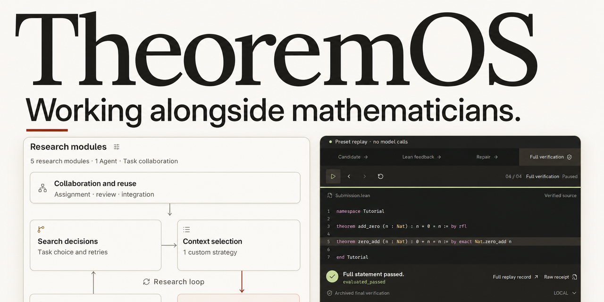
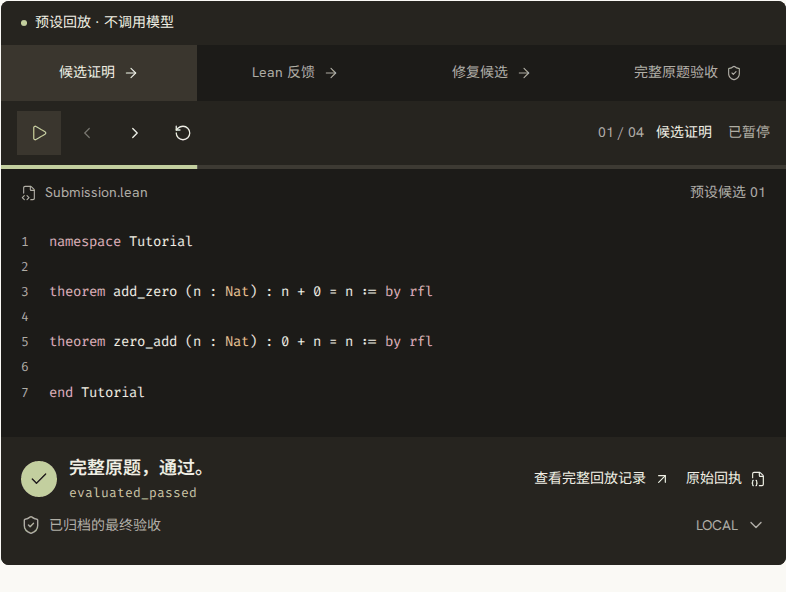

<strong>面向前沿数学研究的 AI 协同系统与形式化证明平台</strong>

  <a href="https://theoremos.top/">🌐 产品官网</a> ·
  <a href="https://theoremos.top/#start"><strong>🚀 申请研究内测</strong></a> ·
  <a href="#核心创新与系统设计">核心创新</a> ·
  <a href="#怎样支持数学研究">研究工作流</a> ·
  <a href="#代表案例">代表案例</a> ·
  <a href="#研究合作">研究合作</a> ·
  <a href="https://theoremos.top/archive.html">📜 证明档案库</a> ·
  <a href="README.md">English</a>

**TheoremOS 是一套与数学家协作攻克高难度证明的 AI 研究系统。** 研究者可用自然语言、TeX 或 Lean 4 提出问题，审核形式化陈述并把控整体方向；系统在给定算力预算内负责检索结论、拆解引理、探索证明，并由独立 Lean 程序严格核验完整证明。您可通过免本地配置的[云端工作台](https://app.theoremos.top/)直接开始使用，或查看[访问说明](docs/ACCESS.md)了解内测申请与 CLI 研究合作。

> **研究内测**：[云端工作台](https://app.theoremos.top/)采用邮箱白名单免费内测（需自备支持 Responses API 的模型密钥）。可通过 [GitHub Issue](https://github.com/LikC1606/TheoremOS/issues/new?template=early-access.yml) 申请开通，CLI 实验与合作方式详见[访问说明](docs/ACCESS.md)。

> 🏆 **研究成果与评测表现**：本仓库公开了系统完成的 **28 条高难度前沿数学证明记录**，涵盖代数数论、黎曼几何、泛函分析与统计物理等领域，其中包括 **[10 份通过 Lean-Eval 官方评测的证明](#lean-eval10-份官方通过的证明)**，以及 **[18 条经本地 Lean 与原题检查程序复核的 OpenAI Math 证明记录](#openai-math18-条证明记录)**。

**从这里开始：**[首次使用图文教程](docs/GETTING-STARTED.zh-CN.md) · [真实研究案例](docs/CASE-STUDY.zh-CN.md) · [能力与开放范围](docs/CAPABILITIES.zh-CN.md) · [评测数据与口径](docs/EVALUATION.zh-CN.md) · [下载真实证明复核包](proof-kits/dimitrov/README.zh-CN.md)

## 证明检查演示

*预设的四步 Lean 检查回放（以 `n + 0 = n` 为例），用于直观展示工作台核验目标与证明的过程。该演示为内置回放，不调用模型，非现场解题评测。*

<b>云端工作台截图</b>

<a href="https://theoremos.top/#start">
  <picture>
    <source media="(max-width: 640px)" srcset="assets/workbench-mobile.png">
    
  </picture>
</a>

云端智能工作台入口 · <a href="assets/workbench-full-desktop.png">点击查看高清完整工作流截图</a>

---

## 核心创新与系统设计

| 核心能力 | 核心机制 | 对数学研究的价值 |
| --- | --- | --- |
| **1. 直接编译与后台题意审核** | 生成并编译 Lean 陈述后即可查看和下载；独立审核会话在后台比较原题、源码与编译后的目标。 | 尽早获得可核对的陈述，并结合具体审核意见检查定义、假设与结论。 |
| **2. 先验证整体路线、再并行证引理** | 先将候选引理作为临时假设检验主定理推导路线是否成立，路线跑通后再并行证明各引理。 | 在深入繁琐细节前先确认高层证明结构可行，让多引理攻关清晰可控。 |
| **3. 全过程留存与跨题引理复用** | 完整保存探索分支与编译报错以支持中断恢复，已验证引理跨题复用时会在目标环境中重新运行 Lean 核验。 | 留存排错脉络与阶段性进展，逐步积累可跨课题安全复用的形式化引理库。 |
| **4. 模块化解耦与受控实验支持** | 将执行、结果检查、搜索调度、上下文管理与职责分配拆分为可替换模块。 | 便于严格控制变量，系统评测不同搜索策略与多角色协作方案。 |

<b>四项核心机制详解</b>

* **🔄 直接编译与独立题意核对**
  输入自然语言或 $\TeX$ 原题后，系统直接生成 Lean 陈述，并根据编译诊断修正代码。首份编译通过的陈述随即固定并提供下载；选择“共同推进”时，由你确认题意与初始计划后继续证明，选择“自动推进”时可直接开始证明研究。独立审核会话同时在后台比较完整原题、固定源码与编译后的目标，检查对象类型、假设、结论、定义、量词范围和实例。审核意见单独保存，不改写陈述，也不中断已经开始的证明。编译通过表示陈述可被 Lean 接受；后台审核是模型意见，题意仍需人工核对，证明还须通过后续独立验收。
* **🧩 围绕主目标的引理拆解与并行合并**
  面对复杂定理，系统支持单点深度推导、多路线并行尝试以及按“规划、检索、证明编写、审阅”进行多角色分工。
  * **假定引理成立的路线预演**：拆解出的每项辅助引理均固定其 Lean 类型与依赖，同时在子任务中保留原题的完整命题与假设，帮助底层推导始终围绕原题展开。在具体引理获证前，系统可先将这些引理类型作为临时假设，用 Lean 检验它们在逻辑上是否足以推出主定理，从而先验证高层证明思路是否走得通。
  * **声明级合并与独立终审**：各分支每次交付均绑定代码版本并核查预期类型与改动声明；多个并行分支的进展按 Lean 声明进行合并（处理独立引理的并行修改，并在发现冲突时清晰报告），随后检验其对主目标的实际应用。当所有引理获证并合并为不依赖临时假设的完整证明后，最终由独立的 Lean 检查程序（及适用的原题比较器）完成终审。
* **🏛️ 透明可控的研究记录与知识索引**
  系统开放整个推演过程，完整记录尝试过的路线、编译反馈、未完成步骤与算力消耗。研究者可随时根据受阻记录调整方向，或保存进度并在后续恢复任务。同时，任何通过 Lean 检查的定理和辅助引理均可显式导入知识索引（完整保留类型签名、前提条件、源码与环境信息），支持结构化检索；在跨课题调用时，系统会在当前 Lean 环境中重新核查，验证通过后即可安全复用。
* **⚙️ 支持严谨对照的模块化实验平台**
  网页端工作台之下，TheoremOS 将底层运行逻辑拆分为五个相互独立的研究决策组件（执行、结果检查、搜索调度、上下文管理、职责分配），并与 Agent 数量解耦。研究人员无需改动系统主干，即可通过源码接口独立替换单一策略，并利用 CLI 工具在固定题目、模型、环境与预算的条件下开展严谨的对照实验。

---

## 怎样支持数学研究

在日常研究工作流中，数学家可以从四个环节切入使用 TheoremOS：

1. **对齐定义与形式化陈述**：直接提交自然语言问题、$\TeX$ 手稿或未完成的 Lean 文件，查看编译后的陈述，结合后台审核的具体意见和人工核对，校准形式化定义与假设。
2. **快速验证高层证明直觉**：提出宏观证明框架或关键中间步骤，让系统将其固定为辅助引理并先行验证“由引理推出主定理”的逻辑链条，快速判断证明思路是否可行。
3. **排查受阻点与注入直觉**：当自动探索受阻时，直观检视已尝试路线与具体编译报错，由人类研究者补充关键条件、修正引理陈述或调整拆解方式，再交由系统继续推进。
4. **沉淀课题组的形式化资产**：将研究过程中证出的技术性引理导入知识索引，供同一方向的新问题直接检索参考，免去重复造轮子的繁琐工作。

---

> 🧭 **迈向“Math 2.0”的协同研究范式**：菲尔兹奖得主陶哲轩（Terence Tao）在其[《Math 2.0》博客](https://terrytao.wordpress.com/2026/10/10/math-2-0/)与 [Caltech 公开讲座讲稿](https://teorth.github.io/tao-web/slides/math-2-0-caltech-2026.pdf)（2026 年 10 月）中指出：
>
> *“The more sustainable ‘Math 2.0’ use of AI would be to strengthen all the ways in which human understanding interacts with mathematics.”*（讲稿第 23 页）\
> *（更具可持续性的 AI “Math 2.0” 用法，应当是全方位强化人类理解与数学产生交互的每一种方式。）*
>
> 他同时强调，数学探索应超越单一的解题指标（Beyond problem-solving，第 9、16 页）——探索过程中的阶段性进展与失败尝试同样具有研究价值；而建设如 Mathlib 般大型高质量的形式化数学库、将零散研究连接为持续更新的知识网络，正是“Math 2.0”的核心应用方向（第 25 页）。**TheoremOS 的设计与这一愿景高度契合：我们不做仅输出结果的黑盒解题器，而是通过严谨的题意对齐、透明的过程记录与引理级知识积累，为数学家提供可靠、可持续的协同研究工具。**

---

## 代表案例

从经典几何定理到前沿统计物理模型，TheoremOS 已在多个核心数学分支的高难度问题中展现出可靠的形式化推演能力：

| 证明案例 | 核心数学结论 | 源码、核查与完整推演记录 |
| --- | --- | --- |
| **[Hopf–Rinow 定理](accepted/hopf_rinow/)** | 在题目给定的流形条件下，严格证明测地完备与度量完备等价。 | [Lean 证明](accepted/hopf_rinow/Submission.lean) · [🏅 官方评测通过](https://github.com/leanprover/lean-eval-submissions/issues/2143#issuecomment-6215093969) |
| **[平面 Anderson 算子谱](docs/CASE-STUDY.zh-CN.md)** | 当 `h > 0`，随机势独立且均匀分布于 `[-h, h]` 时，证明几乎必然谱为 `[-4-h, 4+h]`。 | [题面](data/proofs/openai_planar_anderson_spectrum/Challenge.lean) · [证明](data/proofs/openai_planar_anderson_spectrum/Submission.lean) · [检查结果](data/proofs/openai_planar_anderson_spectrum/verification.json) · [研究过程](data/proofs/openai_planar_anderson_spectrum/process.json) |
| **树上三状态模型的超临界重构** | 在题目给定的超临界条件下，证明正则树与泊松树的重构优势趋于正极限。 | [题面](data/proofs/openai_three_state_supercritical/Challenge.lean) · [证明](data/proofs/openai_three_state_supercritical/Submission.lean) · [检查结果](data/proofs/openai_three_state_supercritical/verification.json) · [研究过程](data/proofs/openai_three_state_supercritical/process.json) |
| **Snaky 获胜策略** | 面对合法应手，严格证明在 35 次 Maker 落子内完成 Snaky，并保持局面合法。 | [题面](data/proofs/openai_snaky_conditional/Challenge.lean) · [证明](data/proofs/openai_snaky_conditional/Submission.lean) · [检查结果](data/proofs/openai_snaky_conditional/verification.json) · [研究过程](data/proofs/openai_snaky_conditional/process.json) |

👉 **[点击查看全部 28 条证明与检查记录](#证明与检查结果)**。

---

## 研究合作

我们向数学界与 AI for Math 领域的学者发出诚挚邀请，欢迎开展以下方向的研究合作：

* **🎓 面向数学研究者**：欢迎带着手头正在攻关的问题、初步思路或尚未完成的 Lean 证明前来交流。我们可以依托 TheoremOS 共同核对定义与假设、推演多条证明路线、排查缺失的关键辅助引理，并评估已有结论能否高效复用，借助 AI 加速研究进程。
* **🤖 面向数学 Agent 研究同行**：欢迎共同探讨搜索策略、上下文选择与多智能体协作机制。系统底层的执行、结果检查、搜索调度、上下文管理和职责分配均为解耦的可替换模块，并配备完整的 CLI 实验工具——欢迎基于此平台开展消融实验，共同探索不同协作模式与决策组件的实际增益。

💌 **联系方式**：有意合作请发送邮件至 **[liuzhenhao@westlake.edu.cn](mailto:liuzhenhao@westlake.edu.cn)**，欢迎附上题目来源或 Lean 陈述、已尝试的方法以及希望共同探讨的问题。公开的学术讨论与功能建议，欢迎随时 **[提交 GitHub Issue](https://github.com/LikC1606/TheoremOS/issues/new)**。

---

## 内测与使用

TheoremOS 目前通过邮箱白名单机制开放研究内测。**内测期间，TheoremOS 平台本身完全免费**，用户仅需使用自己的 API Key 承担大模型调用费用，即可使用整套协同研究系统。

> 💡 **免 Key 在线浏览**：若想先了解系统处理数学难题的运行与推演过程，无需配置 API Key，可直接浏览 **[证明档案库](https://theoremos.top/archive.html)** 或观看 **[示例实机回放](https://theoremos.top/#demo)**。

**内测接入流程：**

1. **申请内测**：通过 **[GitHub Issue 申请通道](https://github.com/LikC1606/TheoremOS/issues/new?template=early-access.yml)** 简要说明研究用途（可选附公开题目或 Lean 陈述链接）；也可直接发邮件至 **[liuzhenhao@westlake.edu.cn](mailto:liuzhenhao@westlake.edu.cn)** 申请。*(安全提示：公开 Issue 中请勿填写 API Key 或个人隐私信息)*
2. **确认白名单权限**：审核通过后，按回复指引通过邮件确认登录邮箱；加入白名单后，使用邮箱验证码即可登录 **[app.theoremos.top](https://app.theoremos.top/)** 云端工作台。
3. **接入模型服务**：连接 OpenAI 或兼容 Responses API 的大模型服务，填写自己的 API Key，选择推理模型并设置形式化与证明预算。
4. **提交任务与核查**：直接提交自然语言、$\TeX$ 或已有的 Lean 题目与未完成证明，在线核对 Lean 陈述，实时查看证明推演过程与模型用量，并可随时一键下载源码、检查报告和复查文件。

---

## 文档、复核指引与反馈

- **首次使用图文教程**：[开始第一项研究](docs/GETTING-STARTED.zh-CN.md) — 模型配置、预算、题面核对、结果查看与下载。
- **真实研究案例**：[平面 Anderson 算子谱](docs/CASE-STUDY.zh-CN.md) — 数学证明路线、探索记录与核查依据。
- **访问与内测说明**：[`docs/ACCESS.md`](docs/ACCESS.md) — 云端工作台白名单申请流程、自备 API Key 要求及 CLI 研究合作联系方式。
- **能力与开放范围**：[网页功能、CLI 研究访问与规划中的能力](docs/CAPABILITIES.zh-CN.md)。
- **评测数据与口径**：[档案构成、逐次运行观测与 JSON/CSV 下载](docs/EVALUATION.zh-CN.md)。
- **完整证明复核包**：[Dimitrov：固定题面、证明、环境、检查脚本与报告](proof-kits/dimitrov/README.zh-CN.md)。
- **证明复核指引**：[`docs/VERIFY.zh-CN.md`](docs/VERIFY.zh-CN.md) — 提供无需 Mathlib 的 Lean 入门检查示例与 Dimitrov 官方冻结工作区复核步骤，并说明全部 28 条公开证明记录的构成（含 10 份具有 Lean-Eval 官方通过记录的证明，以及 18 条经本项目运行 Lean 与原题比较器核验、OpenAI 官方结果尚未确认的记录）。
- **许可与引用**：[`LICENSE`](LICENSE)、[`docs/PUBLIC-MATERIALS.md`](docs/PUBLIC-MATERIALS.md)（公开材料许可说明）与 [`CITATION.cff`](CITATION.cff)。
- **版本记录**：[`CHANGELOG.md`](CHANGELOG.md)。
- **问题反馈与建议**：欢迎通过 [GitHub Issues](https://github.com/LikC1606/TheoremOS/issues/new/choose) 提交内测申请、Bug 报告、功能建议或问题咨询。

---

## 证明与检查结果

### Lean-Eval：10 份官方通过的证明

<b>📂 点击展开：查看全部 10 份通过官方评测的证明</b>

| 证明 | 领域 | 官方结果 |
| --- | --- | --- |
| [群环中的非平凡单位：单位猜想反例](accepted/annals_unit_conjecture/) | 代数 | [🏅 #1246 · 通过](https://github.com/leanprover/lean-eval-submissions/issues/1246#issuecomment-5380977645) |
| [Rademacher 型与 Enflo 型的一致性](accepted/annals_rademacher_enflo_type/) | 泛函分析 | [🏅 #2115 · 通过](https://github.com/leanprover/lean-eval-submissions/issues/2115#issuecomment-6161355838) |
| [固定夹角的等角线](accepted/annals_equiangular_lines_fixed_angle/) | 离散几何 | [🏅 #2135 · 通过](https://github.com/leanprover/lean-eval-submissions/issues/2135#issuecomment-6186332699) |
| [分数期望阈值](accepted/annals_fractional_expectation_thresholds/) | 概率组合 | [🏅 #2141 · 通过](https://github.com/leanprover/lean-eval-submissions/issues/2141#issuecomment-6197783762) |
| [Dimitrov 的代数整数 house 下界](accepted/dimitrov/) | 代数数论 | [🏅 #2143 · 通过](https://github.com/leanprover/lean-eval-submissions/issues/2143#issuecomment-6215093969) |
| [Hopf–Rinow 定理](accepted/hopf_rinow/) | 黎曼几何 | [🏅 #2143 · 通过](https://github.com/leanprover/lean-eval-submissions/issues/2143#issuecomment-6215093969) |
| [向日葵引理的改进界](submitted/annals_improved_bounds_sunflower_lemma/) | 组合数学 | [🏅 #2144 · 通过](https://github.com/leanprover/lean-eval-submissions/issues/2144#issuecomment-6222767100) |
| [Lorentzian 多项式的闭包刻画](submitted/annals_lorentzian_polynomials/) | 代数组合 | [🏅 #2144 · 通过](https://github.com/leanprover/lean-eval-submissions/issues/2144#issuecomment-6222767100) |
| [纸带 Möbius 环的长宽比下界](submitted/annals_optimal_moebius/) | 几何 | [🏅 #2144 · 通过](https://github.com/leanprover/lean-eval-submissions/issues/2144#issuecomment-6222767100) |
| [代数整数：λ_SSS 的上界](submitted/annals_algebraic_integers/) | 代数数论 | [🏅 #2144 · 通过](https://github.com/leanprover/lean-eval-submissions/issues/2144#issuecomment-6222767100) |

模型与来源信息见 [accepted.json](accepted/accepted.json) 和 [submitted.json](submitted/submitted.json)。最后四项在[提交 #2144](https://github.com/leanprover/lean-eval-submissions/issues/2144#issuecomment-6222767100) 中一同通过，源码保存在 `submitted/`。

### OpenAI Math：18 条证明记录

以下 18 条证明记录已由我们运行独立的 Lean 检查程序和原题比较器严格复核（均公开完整研究过程），OpenAI 官方评测结果尚未确认。其中“全部接缝”条目对应所列曲面表示下的辅助结论。

<b>📂 点击展开：查看全部 18 条记录的题目、证明源码、检查结果与完整研究过程</b>

| 题目 | 领域 | 题面与证明 | 检查结果与研究过程 |
| --- | --- | --- | --- |
| 三状态模型在正则树与泊松树上的超临界重构 | 概率论 | [题面](data/proofs/openai_three_state_supercritical/Challenge.lean) · [证明](data/proofs/openai_three_state_supercritical/Submission.lean) | [检查结果](data/proofs/openai_three_state_supercritical/verification.json) · [研究过程](data/proofs/openai_three_state_supercritical/process.json) |
| 三角展开下匹配多面体的面对应 | 组合优化 | [题面](data/proofs/openai_triangle_face/Challenge.lean) · [证明](data/proofs/openai_triangle_face/Submission.lean) | [检查结果](data/proofs/openai_triangle_face/verification.json) · [研究过程](data/proofs/openai_triangle_face/process.json) |
| Koebe 映射及逆映射的端点不可积性 | 复分析 | [题面](data/proofs/openai_brennan_sharp/Challenge.lean) · [证明](data/proofs/openai_brennan_sharp/Submission.lean) | [检查结果](data/proofs/openai_brennan_sharp/verification.json) · [研究过程](data/proofs/openai_brennan_sharp/process.json) |
| 数值域几何与有限维压缩的辅助结果 | 泛函分析 | [题面](data/proofs/openai_hilbert_crouzeix/Challenge.lean) · [证明](data/proofs/openai_hilbert_crouzeix/Submission.lean) | [检查结果](data/proofs/openai_hilbert_crouzeix/verification.json) · [研究过程](data/proofs/openai_hilbert_crouzeix/process.json) |
| 平面 Anderson 算子的几乎必然谱 | 随机算子 | [题面](data/proofs/openai_planar_anderson_spectrum/Challenge.lean) · [证明](data/proofs/openai_planar_anderson_spectrum/Submission.lean) | [检查结果](data/proofs/openai_planar_anderson_spectrum/verification.json) · [研究过程](data/proofs/openai_planar_anderson_spectrum/process.json) |
| Ising 感知器变分值的有限性 | 概率与统计物理 | [题面](data/proofs/openai_ising_finiteness/Challenge.lean) · [证明](data/proofs/openai_ising_finiteness/Submission.lean) | [检查结果](data/proofs/openai_ising_finiteness/verification.json) · [研究过程](data/proofs/openai_ising_finiteness/process.json) |
| 欧拉函数伴随定理：无种子零值情形 | 数论 | [题面](data/proofs/openai_totient_companion_zero/Challenge.lean) · [证明](data/proofs/openai_totient_companion_zero/Submission.lean) | [检查结果](data/proofs/openai_totient_companion_zero/verification.json) · [研究过程](data/proofs/openai_totient_companion_zero/process.json) |
| 归一化 Cartier 坐标回缩族的紧致性 | 代数几何与拓扑 | [题面](data/proofs/openai_cartier_chart_compactness_support/Challenge.lean) · [证明](data/proofs/openai_cartier_chart_compactness_support/Submission.lean) | [检查结果](data/proofs/openai_cartier_chart_compactness_support/verification.json) · [研究过程](data/proofs/openai_cartier_chart_compactness_support/process.json) |
| 有限同余格的彩色图判据 | 泛代数与格论 | [题面](data/proofs/openai_finite_congruence_graph/Challenge.lean) · [证明](data/proofs/openai_finite_congruence_graph/Submission.lean) | [检查结果](data/proofs/openai_finite_congruence_graph/verification.json) · [研究过程](data/proofs/openai_finite_congruence_graph/process.json) |
| 蜂窝格自由能极限的存在性 | 概率与统计物理 | [题面](data/proofs/openai_honeycomb_free_energy/Challenge.lean) · [证明](data/proofs/openai_honeycomb_free_energy/Submission.lean) | [检查结果](data/proofs/openai_honeycomb_free_energy/verification.json) · [研究过程](data/proofs/openai_honeycomb_free_energy/process.json) |
| 欧氏平面的七色着色 | 离散几何 | [题面](data/proofs/openai_plane_coloring/Challenge.lean) · [证明](data/proofs/openai_plane_coloring/Submission.lean) | [检查结果](data/proofs/openai_plane_coloring/verification.json) · [研究过程](data/proofs/openai_plane_coloring/process.json) |
| Snaky 的 35 步合法获胜策略 | 组合博弈 | [题面](data/proofs/openai_snaky_conditional/Challenge.lean) · [证明](data/proofs/openai_snaky_conditional/Submission.lean) | [检查结果](data/proofs/openai_snaky_conditional/verification.json) · [研究过程](data/proofs/openai_snaky_conditional/process.json) |
| Snaky 证书核验 | 组合博弈 | [题面](data/proofs/openai_snaky_certificate/Challenge.lean) · [证明](data/proofs/openai_snaky_certificate/Submission.lean) | [检查结果](data/proofs/openai_snaky_certificate/verification.json) · [研究过程](data/proofs/openai_snaky_certificate/process.json) |
| 六阶 Hadamard 行比值的立方纤维消去 | 线性代数 | [题面](data/proofs/openai_hadamard_cube_fiber/Challenge.lean) · [证明](data/proofs/openai_hadamard_cube_fiber/Submission.lean) | [检查结果](data/proofs/openai_hadamard_cube_fiber/verification.json) · [研究过程](data/proofs/openai_hadamard_cube_fiber/process.json) |
| 三维完备诺特正规局部复代数 | 交换代数 | [题面](data/proofs/openai_surface_cone_candidate_support/Challenge.lean) · [证明](data/proofs/openai_surface_cone_candidate_support/Submission.lean) | [检查结果](data/proofs/openai_surface_cone_candidate_support/verification.json) · [研究过程](data/proofs/openai_surface_cone_candidate_support/process.json) |
| Truffet 优化程序的有限反例 | 热带优化 | [题面](data/proofs/openai_truffet_counterexample/Challenge.lean) · [证明](data/proofs/openai_truffet_counterexample/Submission.lean) | [检查结果](data/proofs/openai_truffet_counterexample/verification.json) · [研究过程](data/proofs/openai_truffet_counterexample/process.json) |
| 三状态树信道的超临界重构 | 概率论 | [题面](data/proofs/openai_three_state_tree_clauses/Challenge.lean) · [证明](data/proofs/openai_three_state_tree_clauses/Submission.lean) | [检查结果](data/proofs/openai_three_state_tree_clauses/verification.json) · [研究过程](data/proofs/openai_three_state_tree_clauses/process.json) |
| 曲面全部接缝标记迹值的辅助结论 | 代数几何 | [题面](data/proofs/openai_character_varieties_all_seams_support/Challenge.lean) · [证明](data/proofs/openai_character_varieties_all_seams_support/Submission.lean) | [检查结果](data/proofs/openai_character_varieties_all_seams_support/verification.json) · [研究过程](data/proofs/openai_character_varieties_all_seams_support/process.json) |

🔍 欢迎前往 **[可视化证明档案库](https://theoremos.top/archive.html)**，直观查看系统完成每道题目的完整推演与研究过程。

---

## 仓库内容

本仓库公开官网页面、证明源码和研究记录；TheoremOS 运行时的源码不公开。

<b>📂 仓库目录与许可</b>

| 路径 | 内容 |
| --- | --- |
| [accepted/](accepted/) | 六份通过 Lean-Eval 官方评测的证明及来源记录 |
| [submitted/](submitted/) | 提交 #2144 中另外四份通过官方评测的证明 |
| [data/proofs/](data/proofs/) | 18 条 OpenAI Math 证明记录，含题目、源码、检查报告和研究过程 |
| [in-progress/](in-progress/) | 早期的 Lean 证明草稿，部分尚未完成，含有 `sorry` |
| [data/catalog.json](data/catalog.json) | 证明档案目录，含进展与检查结果链接 |
| `index.html`, `archive.html`, `feedback.html`, `en/`, `assets/` | 官网、英文页面和工作台截图 |

TheoremOS 保留运行时的所有权利。第三方字体与图标沿用 [assets/fonts/](assets/fonts/)、[assets/licenses/](assets/licenses/) 和 [lucide-LICENSE.txt](lucide-LICENSE.txt) 中随附的许可。

