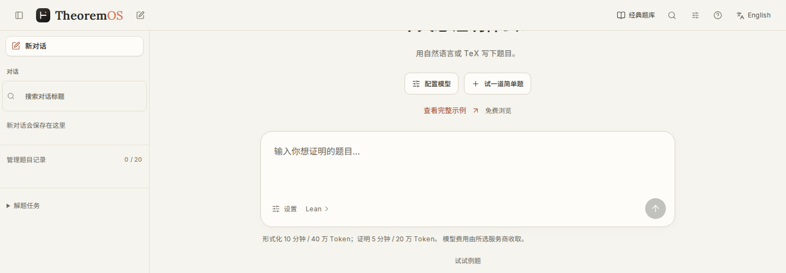

<h1>TheoremOS</h1>

<strong>从数学原题到可独立核查的 Lean 证明。</strong>

面向数学研究者、Lean 用户与数学 Agent 研究者的研究工作台。

  <a href="https://theoremos.top/">产品官网</a> ·
  <a href="https://theoremos.top/#start"><strong>申请研究内测</strong></a> ·
  <a href="#研究合作">研究合作</a> ·
  <a href="https://theoremos.top/archive.html">证明档案</a> ·
  <a href="README.md">English</a>

TheoremOS 将数学 AI Agent、Lean 4 与 Mathlib 整合到浏览器工作台中。你可以输入自然语言、TeX 或已有 Lean 陈述，选择模型与研究预算，查看证明尝试，并下载源码与验收报告。

每次运行将题面、候选证明、Lean 反馈和验收记录保存在一起。陈述含义审核与证明验收分别展示，方便你核对形式化是否表达了原题。

仓库归档 **26 条证明记录**：[10 个 Lean-Eval 官方通过包](#lean-eval10-个官方通过包)和 [16 个 OpenAI Math 本地验收记录](#openai-math16-个本地验收记录)。其中包含 TheoremOS 及前身 DeepScientist / DeepScientist Math 的工作，各条记录保留具体归属。

<a href="https://theoremos.top/#start">
  <picture>
    <source media="(max-width: 640px)" srcset="assets/workbench-mobile.png">
    
  </picture>
</a>

自然语言入口 · 中文界面 · <a href="assets/workbench-full-desktop.png">查看完整截图</a>

## 代表案例

打开题面、证明和验收证据，可以核对每个案例实际证明了什么。本地记录还附有归档的研究过程。

| 案例 | 核查的结论 | 源码与证据 |
| --- | --- | --- |
| [Hopf–Rinow](accepted/hopf_rinow/) | 在归档题面的流形条件下，测地完备与度量完备等价。 | [证明](accepted/hopf_rinow/Submission.lean) · [官方通过](https://github.com/leanprover/lean-eval-submissions/issues/2143#issuecomment-6215093969) |
| 平面 Anderson 算子谱 | 当 `h > 0`，随机势独立且均匀分布于 `[-h, h]` 时，几乎必然谱为 `[-4-h, 4+h]`。 | [题面](data/proofs/openai_planar_anderson_spectrum/Challenge.lean) · [证明](data/proofs/openai_planar_anderson_spectrum/Submission.lean) · [本地通过](data/proofs/openai_planar_anderson_spectrum/verification.json) · [研究过程](data/proofs/openai_planar_anderson_spectrum/process.json) |
| 树上三状态模型的超临界重构 | 在归档的超临界条件下，正则树与泊松树的重构优势趋于正极限。 | [题面](data/proofs/openai_three_state_supercritical/Challenge.lean) · [证明](data/proofs/openai_three_state_supercritical/Submission.lean) · [本地通过](data/proofs/openai_three_state_supercritical/verification.json) · [研究过程](data/proofs/openai_three_state_supercritical/process.json) |
| Snaky 获胜策略 | 面对合法应手，在 35 次 Maker 落子内完成 Snaky，并保持局面合法。 | [题面](data/proofs/openai_snaky_conditional/Challenge.lean) · [证明](data/proofs/openai_snaky_conditional/Submission.lean) · [本地通过](data/proofs/openai_snaky_conditional/verification.json) · [研究过程](data/proofs/openai_snaky_conditional/process.json) |

[查看全部 26 条记录及验收证据](#证明与验收)。

## 研究合作

我们欢迎围绕具体数学问题或研究方法展开合作：

- 带一道假设和目标清楚的数学问题，共同核对 Lean 陈述，讨论证明路线。
- 带一段尚未完成的 Lean 证明，分析缺少的引理，整理可复用的结果。
- 带一种搜索、上下文选择或协作策略，共同设计固定题面、模型、环境和预算的对照实验。

合作请联系 [liuzhenhao@westlake.edu.cn](mailto:liuzhenhao@westlake.edu.cn)，附上题目来源或 Lean 陈述、已经尝试的方法，以及希望一起研究的问题。公开讨论和产品反馈可[提交 Issue](https://github.com/LikC1606/theorem-os-site/issues/new)。

## 内测与使用

当前为**白名单 Beta**。内测期间平台免费，模型调用由你的 API 账户付费；在线使用无需在本机安装 Lean 或 Docker。

1. [申请内测](https://github.com/LikC1606/theorem-os-site/issues/new?template=early-access.yml)，说明研究用途即可，可选附公开题目或 Lean 声明链接。也可发邮件至 [liuzhenhao@westlake.edu.cn](mailto:liuzhenhao@westlake.edu.cn) 私下申请。
2. 审核后，按回复指引通过邮件私下确认登录邮箱。获准加入白名单后，用邮箱验证码登录 [app.theoremos.top](https://app.theoremos.top/)。
3. 连接 OpenAI 或兼容 Responses API 的服务，填写自己的 API Key，并设置形式化与证明预算。
4. 提交自然语言、TeX 或 Lean 原题，核对形式化，查看证明过程，下载源码、验收报告和本地复核包。

Issue 公开显示，请勿填写 API Key 或个人联系方式。

Lean 验收针对固定的形式化陈述，需要将该陈述与原题核对。也可以先浏览[公开档案](https://theoremos.top/archive.html)或查看[预设验证回放](https://theoremos.top/#demo)，无需 API Key。

## 证明与验收

以下列出仓库中的全部证明记录。检查 OpenAI Math 本地记录时，可以按以下顺序阅读：

1. 对照冻结题面 `Challenge.lean` 与验收的 `Submission.lean`，检查具体假设和结论。
2. 在 `verification.json` 中查看目标名称、`proofSha256`、`kernelStatus` 和 `comparatorExitCode`。
3. 根据 `runId` 找到 `process.json` 中对应的运行，查看归档的任务、证明尝试和事件。

### Lean-Eval：10 个官方通过包

展开全部 10 个证明包与官方验收结果

| 证明包 | 领域 | 官方结果 |
| --- | --- | --- |
| [群环中的非平凡单位：单位猜想反例](accepted/annals_unit_conjecture/) | 代数 | [#1246 · 通过](https://github.com/leanprover/lean-eval-submissions/issues/1246#issuecomment-5380977645) |
| [Rademacher 型与 Enflo 型的一致性](accepted/annals_rademacher_enflo_type/) | 泛函分析 | [#2115 · 通过](https://github.com/leanprover/lean-eval-submissions/issues/2115#issuecomment-6161355838) |
| [固定夹角的等角线](accepted/annals_equiangular_lines_fixed_angle/) | 离散几何 | [#2135 · 通过](https://github.com/leanprover/lean-eval-submissions/issues/2135#issuecomment-6186332699) |
| [分数期望阈值](accepted/annals_fractional_expectation_thresholds/) | 概率组合 | [#2141 · 通过](https://github.com/leanprover/lean-eval-submissions/issues/2141#issuecomment-6197783762) |
| [Dimitrov 的代数整数 house 下界](accepted/dimitrov/) | 代数数论 | [#2143 · 通过](https://github.com/leanprover/lean-eval-submissions/issues/2143#issuecomment-6215093969) |
| [Hopf–Rinow 定理](accepted/hopf_rinow/) | 黎曼几何 | [#2143 · 通过](https://github.com/leanprover/lean-eval-submissions/issues/2143#issuecomment-6215093969) |
| [向日葵引理的改进界](submitted/annals_improved_bounds_sunflower_lemma/) | 组合数学 | [#2144 · 通过](https://github.com/leanprover/lean-eval-submissions/issues/2144#issuecomment-6222767100) |
| [Lorentzian 多项式的闭包刻画](submitted/annals_lorentzian_polynomials/) | 代数组合 | [#2144 · 通过](https://github.com/leanprover/lean-eval-submissions/issues/2144#issuecomment-6222767100) |
| [纸带 Möbius 环的长宽比下界](submitted/annals_optimal_moebius/) | 几何 | [#2144 · 通过](https://github.com/leanprover/lean-eval-submissions/issues/2144#issuecomment-6222767100) |
| [代数整数：λ_SSS 的上界](submitted/annals_algebraic_integers/) | 代数数论 | [#2144 · 通过](https://github.com/leanprover/lean-eval-submissions/issues/2144#issuecomment-6222767100) |

这些证明包包含 DeepScientist / DeepScientist Math 及后续工作的成果，其中涉及历史续跑与环境迁移。原始模型归属、源码版本和 SHA-256 校验值保留在 [accepted.json](accepted/accepted.json) 与 [submitted.json](submitted/submitted.json) 中。这些历史成果不构成当前版本从零求解的成功率评测。

最后四个证明包在[提交 #2144](https://github.com/leanprover/lean-eval-submissions/issues/2144#issuecomment-6222767100) 中一起通过，沿用原来的 `submitted/` 路径。官方通过以链接的 Lean-Eval 回复为依据；各包内的 `verification.json` 记录特定源码与环境下的本地检查。

### OpenAI Math：16 个本地验收记录

展开全部 16 道题的题面、证明与本地验收记录

每道题都有 TheoremOS 原生的 `evaluated_passed` 记录，通过 Lean 内核检查和原比较器的本地验收。尚未确认 OpenAI 托管的官方验收结果。

| 任务记录 | 领域 | 题面与证明 | 验收与过程 |
| --- | --- | --- | --- |
| 三状态模型在正则树与泊松树上的超临界重构 | 概率论 | [题面](data/proofs/openai_three_state_supercritical/Challenge.lean) · [证明](data/proofs/openai_three_state_supercritical/Submission.lean) | [本地通过](data/proofs/openai_three_state_supercritical/verification.json) · [研究过程](data/proofs/openai_three_state_supercritical/process.json) |
| 三角展开下匹配多面体的面对应 | 组合优化 | [题面](data/proofs/openai_triangle_face/Challenge.lean) · [证明](data/proofs/openai_triangle_face/Submission.lean) | [本地通过](data/proofs/openai_triangle_face/verification.json) · [研究过程](data/proofs/openai_triangle_face/process.json) |
| Koebe 映射及逆映射的端点不可积性 | 复分析 | [题面](data/proofs/openai_brennan_sharp/Challenge.lean) · [证明](data/proofs/openai_brennan_sharp/Submission.lean) | [本地通过](data/proofs/openai_brennan_sharp/verification.json) · [研究过程](data/proofs/openai_brennan_sharp/process.json) |
| 数值域几何与有限维压缩的辅助结果 | 泛函分析 | [题面](data/proofs/openai_hilbert_crouzeix/Challenge.lean) · [证明](data/proofs/openai_hilbert_crouzeix/Submission.lean) | [本地通过](data/proofs/openai_hilbert_crouzeix/verification.json) · [研究过程](data/proofs/openai_hilbert_crouzeix/process.json) |
| 平面 Anderson 算子的几乎必然谱 | 随机算子 | [题面](data/proofs/openai_planar_anderson_spectrum/Challenge.lean) · [证明](data/proofs/openai_planar_anderson_spectrum/Submission.lean) | [本地通过](data/proofs/openai_planar_anderson_spectrum/verification.json) · [研究过程](data/proofs/openai_planar_anderson_spectrum/process.json) |
| Ising 感知器变分值的有限性 | 概率与统计物理 | [题面](data/proofs/openai_ising_finiteness/Challenge.lean) · [证明](data/proofs/openai_ising_finiteness/Submission.lean) | [本地通过](data/proofs/openai_ising_finiteness/verification.json) · [研究过程](data/proofs/openai_ising_finiteness/process.json) |
| 欧拉函数伴随定理：无种子零值情形 | 数论 | [题面](data/proofs/openai_totient_companion_zero/Challenge.lean) · [证明](data/proofs/openai_totient_companion_zero/Submission.lean) | [本地通过](data/proofs/openai_totient_companion_zero/verification.json) · [研究过程](data/proofs/openai_totient_companion_zero/process.json) |
| 归一化 Cartier 坐标回缩族的紧致性 | 代数几何与拓扑 | [题面](data/proofs/openai_cartier_chart_compactness_support/Challenge.lean) · [证明](data/proofs/openai_cartier_chart_compactness_support/Submission.lean) | [本地通过](data/proofs/openai_cartier_chart_compactness_support/verification.json) · [研究过程](data/proofs/openai_cartier_chart_compactness_support/process.json) |
| 有限同余格的彩色图判据 | 泛代数与格论 | [题面](data/proofs/openai_finite_congruence_graph/Challenge.lean) · [证明](data/proofs/openai_finite_congruence_graph/Submission.lean) | [本地通过](data/proofs/openai_finite_congruence_graph/verification.json) · [研究过程](data/proofs/openai_finite_congruence_graph/process.json) |
| 蜂窝格自由能极限的存在性 | 概率与统计物理 | [题面](data/proofs/openai_honeycomb_free_energy/Challenge.lean) · [证明](data/proofs/openai_honeycomb_free_energy/Submission.lean) | [本地通过](data/proofs/openai_honeycomb_free_energy/verification.json) · [研究过程](data/proofs/openai_honeycomb_free_energy/process.json) |
| 欧氏平面的七色着色 | 离散几何 | [题面](data/proofs/openai_plane_coloring/Challenge.lean) · [证明](data/proofs/openai_plane_coloring/Submission.lean) | [本地通过](data/proofs/openai_plane_coloring/verification.json) · [研究过程](data/proofs/openai_plane_coloring/process.json) |
| Snaky 的 35 步合法获胜策略 | 组合博弈 | [题面](data/proofs/openai_snaky_conditional/Challenge.lean) · [证明](data/proofs/openai_snaky_conditional/Submission.lean) | [本地通过](data/proofs/openai_snaky_conditional/verification.json) · [研究过程](data/proofs/openai_snaky_conditional/process.json) |
| Snaky 证书核验 | 组合博弈 | [题面](data/proofs/openai_snaky_certificate/Challenge.lean) · [证明](data/proofs/openai_snaky_certificate/Submission.lean) | [本地通过](data/proofs/openai_snaky_certificate/verification.json) · [研究过程](data/proofs/openai_snaky_certificate/process.json) |
| 六阶 Hadamard 行比值的立方纤维消去 | 线性代数 | [题面](data/proofs/openai_hadamard_cube_fiber/Challenge.lean) · [证明](data/proofs/openai_hadamard_cube_fiber/Submission.lean) | [本地通过](data/proofs/openai_hadamard_cube_fiber/verification.json) · [研究过程](data/proofs/openai_hadamard_cube_fiber/process.json) |
| 三维完备诺特正规局部复代数 | 交换代数 | [题面](data/proofs/openai_surface_cone_candidate_support/Challenge.lean) · [证明](data/proofs/openai_surface_cone_candidate_support/Submission.lean) | [本地通过](data/proofs/openai_surface_cone_candidate_support/verification.json) · [研究过程](data/proofs/openai_surface_cone_candidate_support/process.json) |
| Truffet 优化程序的有限反例 | 热带优化 | [题面](data/proofs/openai_truffet_counterexample/Challenge.lean) · [证明](data/proofs/openai_truffet_counterexample/Submission.lean) | [本地通过](data/proofs/openai_truffet_counterexample/verification.json) · [研究过程](data/proofs/openai_truffet_counterexample/process.json) |

数量按归档任务记录统计，一个任务可能包含多个固定的定理声明。Snaky 策略与证书分别计数，欧拉函数结果限定于无种子零值情形。各记录保留准确陈述、源码校验值与归属；外部数学辅助、候选交接和续跑按实际情况注明。

也可在[交互式证明档案](https://theoremos.top/archive.html)中浏览研究过程。历史研究快照使用单独的状态标签。

## 仓库内容

TheoremOS 是闭源软件。本仓库发布官网、证明源码和研究记录；运行时源码不公开。

仓库目录与许可

| 路径 | 内容 |
| --- | --- |
| [accepted/](accepted/) | 六个 Lean-Eval 官方通过包及其来源记录 |
| [submitted/](submitted/) | 提交 #2144 中另外四个已获官方通过的证明包 |
| [data/proofs/](data/proofs/) | 16 个 OpenAI Math 本地验收记录，含题面、证明源码、验收报告和研究过程 |
| [in-progress/](in-progress/) | 部分历史 Lean 研究快照；未完成的草稿可能含有 `sorry` |
| [data/catalog.json](data/catalog.json) | 交互式档案目录，含状态与证据链接 |
| `index.html`, `archive.html`, `feedback.html`, `en/`, `assets/` | 官网、英文页面和工作台截图 |

TheoremOS 保留运行时的所有权利。第三方字体与图标沿用 [assets/fonts/](assets/fonts/)、[assets/licenses/](assets/licenses/) 和 [lucide-LICENSE.txt](lucide-LICENSE.txt) 中随附的许可。

