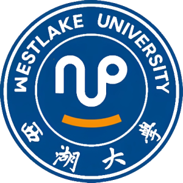
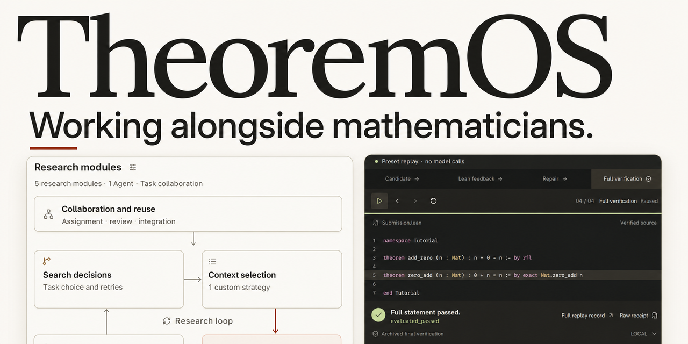
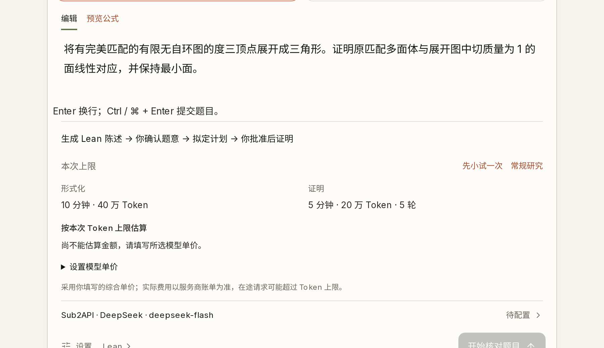
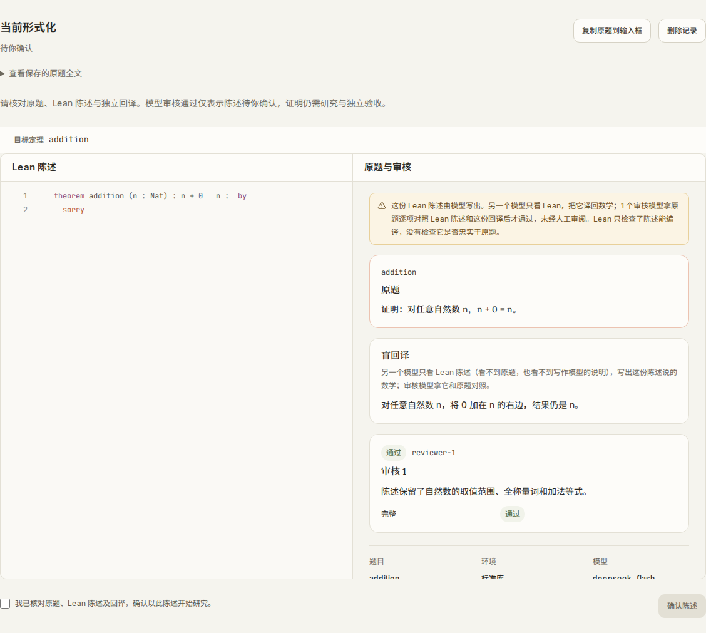
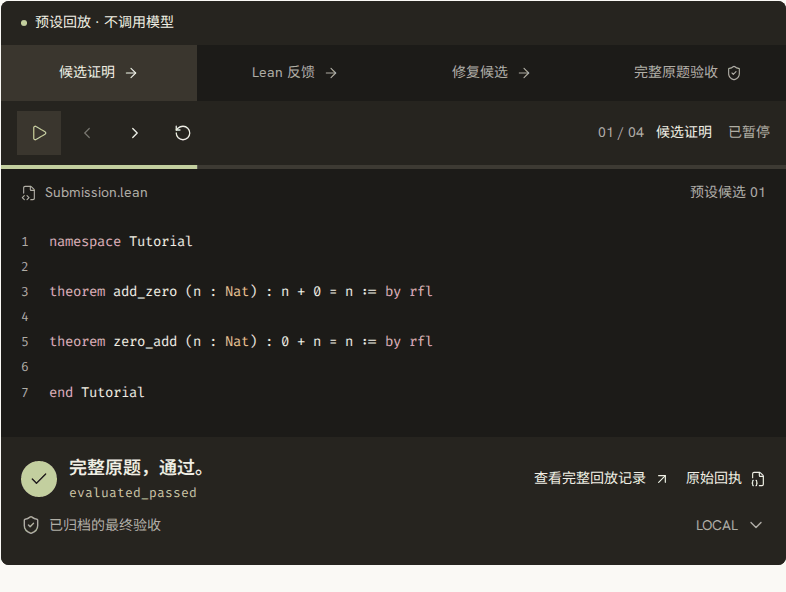
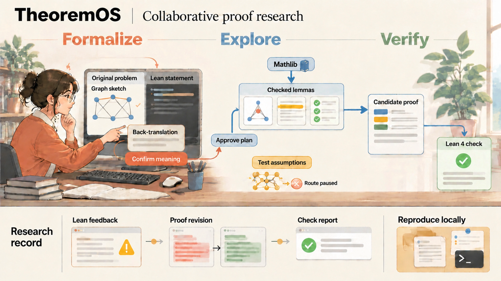
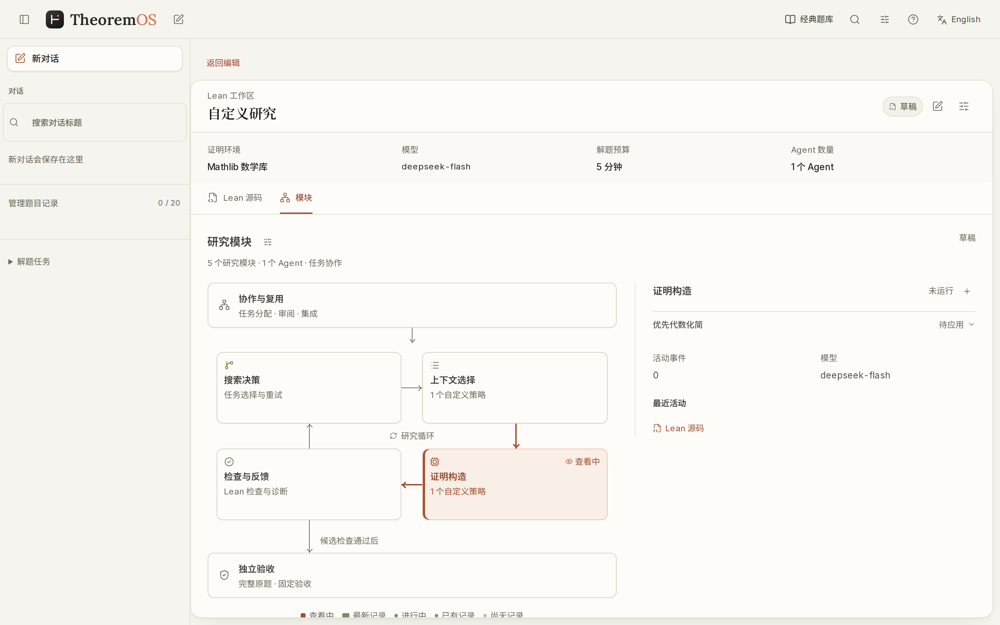

<!-- README_SYNC: source=16ba55670be597f22058a32c185727a047f63791; updated=2026-11-24 -->
<div align="center">
  <p>简体中文 · <a href="./README.md" lang="en">English</a></p>
  <picture>
    <source media="(prefers-color-scheme: dark)" srcset="./assets/readme-mark-dark.svg">
    <source media="(prefers-color-scheme: light)" srcset="./assets/readme-mark.svg">
    
  </picture>
  <h1>TheoremOS</h1>
  <p><strong>人机协同的 Lean 4 数学证明工作台 —— 形式化命题、引理探索与独立内核核验。</strong></p>
  <p>
    由<a href="https://www.westlake.edu.cn/">西湖大学</a>
    <a href="https://westlakenlp.com/"> <strong>WestlakeNLP 实验室</strong></a>（自然语言处理实验室）研发
  </p>
  <p>
    <a href="https://github.com/HuggingMath/TheoremOS"><strong>⭐ 点赞收藏</strong></a> ·
    <a href="https://theoremos.top/">产品官网</a> ·
    <a href="https://theoremos.top/archive.html">证明档案</a> ·
    <a href="https://github.com/HuggingMath/theorem-os">工作台与 CLI 源码</a> ·
    <a href="./docs/ACCESS.md">访问说明</a> ·
    <a href="./docs/VERIFY.zh-CN.md">本地复核</a> ·
    <a href="./CITATION.cff">引用本项目</a>
  </p>
  <p>
    <a href="https://github.com/HuggingMath/TheoremOS"></a>
    <a href="https://westlakenlp.com/"></a>
    <a href="./CHANGELOG.md"></a>
    <a href="./docs/VERIFY.zh-CN.md"></a>
    <a href="https://github.com/HuggingMath/theorem-os"></a>
    <a href="./LICENSE"></a>
  </p>
  <br>
  <a href="https://theoremos.top/">
    
  </a>
</div>

TheoremOS 致力于与数学研究者协同构造严谨的形式化证明：由研究者提出数学问题、核对生成的 Lean 4 形式化陈述并把控引理拆解与研究路线，系统承担 Mathlib 检索、并行候选探索，并交由独立的 Lean 4 内核完成最终验收。

> [!TIP]
> **觉得项目有帮助？** 欢迎点击右上角给 [**HuggingMath/TheoremOS**](https://github.com/HuggingMath/TheoremOS)（以及开源工作台与 CLI 仓库 [**HuggingMath/theorem-os**](https://github.com/HuggingMath/theorem-os)）点亮 **⭐ Star**！你的支持能帮助更多数学与 AI4Science 研究者发现我们的公开证明档案、独立复核包与 [WestlakeNLP](https://westlakenlp.com/) 后续更新。

### 核心亮点

| 高难度公开证明档案 | 人机协同与过程可控 | 完整开源与零密钥本地复现 |
| :--- | :--- | :--- |
| 收录 **10 份 Lean-Eval 官方通过证明**（含*单位猜想*、*Hopf–Rinow 定理*、*Dimitrov 下界*、*向日葵引理改进界*、*Lorentzian 多项式*等）与 **18 条本地核验的 OpenAI Math 记录**及完整研究轨迹（[来源口径](#公开证明证据)）。 | 在启动大规模探索前通过**独立盲回译**把关形式化陈述，支持先验路线再补引理、实时干预计划与已验证引理跨任务复用。 | 无需模型 API Key 即可通过 [Dimitrov 复核包](./proof-kits/dimitrov/README.zh-CN.md)在本地独立核验，完整网页工作台、CLI 与 M1–M5 组件已在 [HuggingMath/theorem-os](https://github.com/HuggingMath/theorem-os) 以 `AGPL-3.0-only` 开源。 |

| 仓库 | 定位与内容 | 许可证 |
| --- | --- | --- |
| [HuggingMath/TheoremOS](https://github.com/HuggingMath/TheoremOS) | [项目官网](https://theoremos.top/)、29 条公开证明档案、Dimitrov 独立复核包与双语文档 | [保留权利](./LICENSE) |
| [HuggingMath/theorem-os](https://github.com/HuggingMath/theorem-os) | 开源网页工作台、命令行工具（`bun run math`）与 M1–M5 可替换组件 | [AGPL-3.0-only](https://github.com/HuggingMath/theorem-os/blob/main/LICENSE) |

---

## 快速开始

| 你想做什么 | 从哪里开始 | 需要准备 |
| --- | --- | --- |
| **免账号浏览已验证证明与过程** | [中文证明档案](https://theoremos.top/archive.html) · [English](https://theoremos.top/en/archive.html) · [案例研究](./docs/CASE-STUDY.zh-CN.md) | 浏览器即可（无需账号） |
| **在本地独立复核证明** | [Lean 复核指引](./docs/VERIFY.zh-CN.md) · [Dimitrov 复核包](./proof-kits/dimitrov/README.zh-CN.md) | 本地 Lean / Python / Git（无需模型 Key） |
| **在云端工作台发起研究任务** | [申请内测](https://github.com/HuggingMath/TheoremOS/issues/new?template=early-access.yml) · [登录工作台](https://app.theoremos.top/) · [首次使用教程](./docs/GETTING-STARTED.zh-CN.md) | 白名单邮箱与支持 Responses API 的模型 Key |
| **本地部署或替换 M1–M5 策略** | [HuggingMath/theorem-os](https://github.com/HuggingMath/theorem-os) · [能力与开放范围](./docs/CAPABILITIES.zh-CN.md) | 本地 TypeScript / Lean 运行环境（`AGPL-3.0-only`） |
| **将归档引理复用到新题目** | [复用归档证明指南](./docs/PROOF-REUSE.zh-CN.md) | 本地 Lean 4 工作区 |

<details>
<summary><b>三行命令本地复核预设 Lean 示例（无需下载 Mathlib 或模型 Key）</b></summary>

```bash
git clone https://github.com/HuggingMath/TheoremOS.git && cd TheoremOS
elan toolchain install leanprover/lean4:v4.33.0
lean +leanprover/lean4:v4.33.0 examples/lean-check/Submission.lean
```

</details>

---

## 工作台界面与验收回放

<a href="./assets/workbench-desktop.png"></a>
<p align="center"><sub><strong>第 1 步 · 题目输入与协同模式</strong> — 支持自然语言、TeX 与单文件 Lean 输入、共同推进/自动推进模式及预算控制（<a href="./assets/workbench-desktop-en.png">EN Screenshot</a>）。</sub></p>

<table width="100%">
  <tr>
    <td width="50%" align="center" valign="middle">
      <a href="./assets/guide/statement-review-zh.png"></a>
    </td>
    <td width="50%" align="center" valign="middle">
      <a href="./assets/proof-replay-zh.gif"></a>
    </td>
  </tr>
  <tr>
    <td width="50%" align="center" valign="top">
      <sub><strong>第 2 步 · 题意与陈述审核</strong> — 对照原题、Lean 4 陈述与独立盲回译结果，确认语义一致后再启动证明（<a href="./assets/guide/statement-review-en.png">EN Screenshot</a>）。</sub>
    </td>
    <td width="50%" align="center" valign="top">
      <sub><strong>第 3 步 · 四步验收回放</strong> — 展示“候选证明 → Lean 诊断 → 修正候选 → 独立内核验收”闭环（<a href="./assets/proof-replay-en.gif">EN Replay</a>）。</sub>
    </td>
  </tr>
</table>

---

## 协同证明流程

1. **题意核对与形式化** — 提交自然语言、TeX 或单个未完成 Lean 文件，系统生成可编译的 Lean 陈述并提供对照回译审查，确保语义准确后再启动探索。
2. **路线检验与引理拆解** — 先暂时假设候选引理验证其能否推出主定理，再分头补全引理证明并汇总检查，去掉所有临时 `sorry` 假设。
3. **尝试追溯与引理复用** — 完整记录每次证明尝试与 Lean 诊断信息，方便研究者随时介入调整；已验证引理可在新题目的 Lean 环境中重新核验后复用。
4. **开源 CLI 与研究策略消融** — 工作台、CLI 与可替换的 M1–M5 研究组件（构造、反馈、搜索、上下文、协作）已在 [HuggingMath/theorem-os](https://github.com/HuggingMath/theorem-os) 以 `AGPL-3.0-only` 开源。自定义 Lake 工程或联合评测详见[能力与开放范围（中文）](./docs/CAPABILITIES.zh-CN.md)（[EN](./docs/CAPABILITIES.md)）。

<details>
<summary><b>查看完整协同流程图与五模块研究架构图</b></summary>
<br>
<table width="100%">
  <tr>
    <td width="50%" align="center" valign="middle">
      
    </td>
    <td width="50%" align="center" valign="middle">
      
    </td>
  </tr>
  <tr>
    <td width="50%" align="center" valign="top">
      <sub>从形式化、引理探索到独立核验与本地复现</sub>
    </td>
    <td width="50%" align="center" valign="top">
      <sub>M1–M5 可替换策略循环与固定 S3 独立验收分离（<a href="./assets/workbench-modules-desktop-en.png">EN Diagram</a>）</sub>
    </td>
  </tr>
</table>
</details>

---

## 公开证明证据

| 来源合集 | 条目数 | 核验依据 | 查看目录 |
| --- | :---: | --- | --- |
| **Lean-Eval** | **10** | 拥有 Lean-Eval 官方评测通过记录（对应冻结提交版本） | [accepted/](./accepted/) · [submitted/](./submitted/) |
| **OpenAI Math** | **18** | 经本地 Lean 4 与原题比较器核验通过 *（无 OpenAI 官方确认）* | [data/proofs/](./data/proofs/) |
| **进行中记录** | **1** | 已归档研究草稿快照 | [in-progress/](./in-progress/) |

> [!NOTE]
> [档案目录](./data/catalog.json)共收录 29 条记录。其中 OpenAI Math 部分个别条目验证的是辅助结论或条件命题，[评测数据与口径（中文）](./docs/EVALUATION.zh-CN.md)（[EN](./docs/EVALUATION.md)）仅介绍早期归档快照的选定运行记录，不能据此推算全系统的成功率或成本。

### Lean-Eval：10 份官方通过的证明

<details>
<summary><b>查看全部 10 份通过官方评测的证明</b></summary>

| 证明 | 领域 | 官方结果 |
| --- | --- | --- |
| [群环中的非平凡单位：单位猜想反例](accepted/annals_unit_conjecture/) | 代数 | [#1246 · 通过](https://github.com/leanprover/lean-eval-submissions/issues/1246#issuecomment-5380977645) |
| [Rademacher 型与 Enflo 型的一致性](accepted/annals_rademacher_enflo_type/) | 泛函分析 | [#2115 · 通过](https://github.com/leanprover/lean-eval-submissions/issues/2115#issuecomment-6161355838) |
| [固定夹角的等角线](accepted/annals_equiangular_lines_fixed_angle/) | 离散几何 | [#2135 · 通过](https://github.com/leanprover/lean-eval-submissions/issues/2135#issuecomment-6186332699) |
| [分数期望阈值](accepted/annals_fractional_expectation_thresholds/) | 概率组合 | [#2141 · 通过](https://github.com/leanprover/lean-eval-submissions/issues/2141#issuecomment-6197783762) |
| [Dimitrov 的代数整数 house 下界](accepted/dimitrov/) | 代数数论 | [#2143 · 通过](https://github.com/leanprover/lean-eval-submissions/issues/2143#issuecomment-6215093969) |
| [Hopf–Rinow 定理](accepted/hopf_rinow/) | 黎曼几何 | [#2143 · 通过](https://github.com/leanprover/lean-eval-submissions/issues/2143#issuecomment-6215093969) |
| [向日葵引理的改进界](submitted/annals_improved_bounds_sunflower_lemma/) | 组合数学 | [#2144 · 通过](https://github.com/leanprover/lean-eval-submissions/issues/2144#issuecomment-6222767100) |
| [Lorentzian 多项式的闭包刻画](submitted/annals_lorentzian_polynomials/) | 代数组合 | [#2144 · 通过](https://github.com/leanprover/lean-eval-submissions/issues/2144#issuecomment-6222767100) |
| [纸带 Möbius 环的长宽比下界](submitted/annals_optimal_moebius/) | 几何 | [#2144 · 通过](https://github.com/leanprover/lean-eval-submissions/issues/2144#issuecomment-6222767100) |
| [代数整数：λ_SSS 的上界](submitted/annals_algebraic_integers/) | 代数数论 | [#2144 · 通过](https://github.com/leanprover/lean-eval-submissions/issues/2144#issuecomment-6222767100) |

模型与来源信息见 [`accepted.json`](accepted/accepted.json) 和 [`submitted.json`](submitted/submitted.json)。最后四项在[提交 #2144](https://github.com/leanprover/lean-eval-submissions/issues/2144#issuecomment-6222767100) 中一同通过，源码保存在 [`submitted/`](submitted/)。

</details>

### OpenAI Math：18 条本地核验记录

<details>
<summary><b>查看全部 18 条记录的题目、证明源码、检查结果与完整研究过程</b></summary>

| 题目 | 领域 | 题面与证明 | 检查结果与研究过程 |
| --- | --- | --- | --- |
| 三状态模型在正则树与泊松树上的超临界重构 | 概率论 | [题面](data/proofs/openai_three_state_supercritical/Challenge.lean) · [证明](data/proofs/openai_three_state_supercritical/Submission.lean) | [检查结果](data/proofs/openai_three_state_supercritical/verification.json) · [研究过程](data/proofs/openai_three_state_supercritical/process.json) |
| 三角展开下匹配多面体的面对应 | 组合优化 | [题面](data/proofs/openai_triangle_face/Challenge.lean) · [证明](data/proofs/openai_triangle_face/Submission.lean) | [检查结果](data/proofs/openai_triangle_face/verification.json) · [研究过程](data/proofs/openai_triangle_face/process.json) |
| Koebe 映射及逆映射的端点不可积性 | 复分析 | [题面](data/proofs/openai_brennan_sharp/Challenge.lean) · [证明](data/proofs/openai_brennan_sharp/Submission.lean) | [检查结果](data/proofs/openai_brennan_sharp/verification.json) · [研究过程](data/proofs/openai_brennan_sharp/process.json) |
| 数值域几何与有限维压缩的辅助结果 | 泛函分析 | [题面](data/proofs/openai_hilbert_crouzeix/Challenge.lean) · [证明](data/proofs/openai_hilbert_crouzeix/Submission.lean) | [检查结果](data/proofs/openai_hilbert_crouzeix/verification.json) · [研究过程](data/proofs/openai_hilbert_crouzeix/process.json) |
| 平面 Anderson 算子的几乎必然谱 | 随机算子 | [题面](data/proofs/openai_planar_anderson_spectrum/Challenge.lean) · [证明](data/proofs/openai_planar_anderson_spectrum/Submission.lean) | [检查结果](data/proofs/openai_planar_anderson_spectrum/verification.json) · [研究过程](data/proofs/openai_planar_anderson_spectrum/process.json) |
| Ising 感知器变分值的有限性 | 概率与统计物理 | [题面](data/proofs/openai_ising_finiteness/Challenge.lean) · [证明](data/proofs/openai_ising_finiteness/Submission.lean) | [检查结果](data/proofs/openai_ising_finiteness/verification.json) · [研究过程](data/proofs/openai_ising_finiteness/process.json) |
| 欧拉函数伴随定理：无种子零值情形 | 数论 | [题面](data/proofs/openai_totient_companion_zero/Challenge.lean) · [证明](data/proofs/openai_totient_companion_zero/Submission.lean) | [检查结果](data/proofs/openai_totient_companion_zero/verification.json) · [研究过程](data/proofs/openai_totient_companion_zero/process.json) |
| 归一化 Cartier 坐标回缩族的紧致性 | 代数几何与拓扑 | [题面](data/proofs/openai_cartier_chart_compactness_support/Challenge.lean) · [证明](data/proofs/openai_cartier_chart_compactness_support/Submission.lean) | [检查结果](data/proofs/openai_cartier_chart_compactness_support/verification.json) · [研究过程](data/proofs/openai_cartier_chart_compactness_support/process.json) |
| 有限同余格的彩色图判据 | 泛代数与格论 | [题面](data/proofs/openai_finite_congruence_graph/Challenge.lean) · [证明](data/proofs/openai_finite_congruence_graph/Submission.lean) | [检查结果](data/proofs/openai_finite_congruence_graph/verification.json) · [研究过程](data/proofs/openai_finite_congruence_graph/process.json) |
| 蜂窝格自由能极限的存在性 | 概率与统计物理 | [题面](data/proofs/openai_honeycomb_free_energy/Challenge.lean) · [证明](data/proofs/openai_honeycomb_free_energy/Submission.lean) | [检查结果](data/proofs/openai_honeycomb_free_energy/verification.json) · [研究过程](data/proofs/openai_honeycomb_free_energy/process.json) |
| 欧氏平面的七色着色 | 离散几何 | [题面](data/proofs/openai_plane_coloring/Challenge.lean) · [证明](data/proofs/openai_plane_coloring/Submission.lean) | [检查结果](data/proofs/openai_plane_coloring/verification.json) · [研究过程](data/proofs/openai_plane_coloring/process.json) |
| Snaky 的 35 步合法获胜策略 | 组合博弈 | [题面](data/proofs/openai_snaky_conditional/Challenge.lean) · [证明](data/proofs/openai_snaky_conditional/Submission.lean) | [检查结果](data/proofs/openai_snaky_conditional/verification.json) · [研究过程](data/proofs/openai_snaky_conditional/process.json) |
| Snaky 证书核验 | 组合博弈 | [题面](data/proofs/openai_snaky_certificate/Challenge.lean) · [证明](data/proofs/openai_snaky_certificate/Submission.lean) | [检查结果](data/proofs/openai_snaky_certificate/verification.json) · [研究过程](data/proofs/openai_snaky_certificate/process.json) |
| 六阶 Hadamard 行比值的立方纤维消去 | 线性代数 | [题面](data/proofs/openai_hadamard_cube_fiber/Challenge.lean) · [证明](data/proofs/openai_hadamard_cube_fiber/Submission.lean) | [检查结果](data/proofs/openai_hadamard_cube_fiber/verification.json) · [研究过程](data/proofs/openai_hadamard_cube_fiber/process.json) |
| 三维完备诺特正规局部复代数 | 交换代数 | [题面](data/proofs/openai_surface_cone_candidate_support/Challenge.lean) · [证明](data/proofs/openai_surface_cone_candidate_support/Submission.lean) | [检查结果](data/proofs/openai_surface_cone_candidate_support/verification.json) · [研究过程](data/proofs/openai_surface_cone_candidate_support/process.json) |
| Truffet 优化程序的有限反例 | 热带优化 | [题面](data/proofs/openai_truffet_counterexample/Challenge.lean) · [证明](data/proofs/openai_truffet_counterexample/Submission.lean) | [检查结果](data/proofs/openai_truffet_counterexample/verification.json) · [研究过程](data/proofs/openai_truffet_counterexample/process.json) |
| 三状态树信道的超临界重构 | 概率论 | [题面](data/proofs/openai_three_state_tree_clauses/Challenge.lean) · [证明](data/proofs/openai_three_state_tree_clauses/Submission.lean) | [检查结果](data/proofs/openai_three_state_tree_clauses/verification.json) · [研究过程](data/proofs/openai_three_state_tree_clauses/process.json) |
| 曲面全部接缝标记迹值的辅助结论 | 代数几何 | [题面](data/proofs/openai_character_varieties_all_seams_support/Challenge.lean) · [证明](data/proofs/openai_character_varieties_all_seams_support/Submission.lean) | [检查结果](data/proofs/openai_character_varieties_all_seams_support/verification.json) · [研究过程](data/proofs/openai_character_varieties_all_seams_support/process.json) |

</details>

---

## 仓库目录结构

| 路径 | 内容说明 |
| --- | --- |
| [accepted/](./accepted/) · [submitted/](./submitted/) | Lean-Eval 证明包及官方结果来源记录 |
| [data/proofs/](./data/proofs/) | OpenAI Math 题面、证明源码、本地核验报告与完整研究轨迹 |
| [in-progress/](./in-progress/) | 早期研究草稿，部分含未闭合的 `sorry` |
| [proof-kits/](./proof-kits/) · [examples/](./examples/) | Dimitrov 独立复核包与简短的 Lean 引理复用示例 |
| [docs/](./docs/) · [CHANGELOG.md](./CHANGELOG.md) | 访问、复核、复用、能力边界、评测口径与版本说明 |

---

## 关于 WestlakeNLP

<table width="100%">
  <tr>
    <td width="124" align="center" valign="middle">
      <a href="https://westlakenlp.com/">
        
      </a>
    </td>
    <td valign="middle">
      TheoremOS 由<a href="https://www.westlake.edu.cn/">西湖大学</a> <a href="https://westlakenlp.com/"><strong>WestlakeNLP 实验室</strong></a>（自然语言处理实验室，2018 年成立，由<a href="https://en.westlake.edu.cn/faculty/nlp/yue-zhang.html">张岳教授</a>领导）研发。实验室围绕自然语言处理、大模型推理与 AI for Science 开展基础与应用研究，致力于探索辅助自然科学与人文社科发现的智能系统。
      <br><br>
      <strong>实验室官网：</strong><a href="https://westlakenlp.com/">westlakenlp.com</a> ·
      <strong>X (Twitter)：</strong><a href="https://x.com/NlpWestlake">@NlpWestlake</a> ·
      <strong>联系邮箱：</strong><a href="mailto:liuzhenhao@westlake.edu.cn">liuzhenhao@westlake.edu.cn</a>
    </td>
  </tr>
</table>

## 许可与引用

本仓库自有公开网站与文档材料按 [LICENSE](./LICENSE) 保留权利；开源工作台与 CLI（[HuggingMath/theorem-os](https://github.com/HuggingMath/theorem-os)）采用 `AGPL-3.0-only`；归档证明与第三方材料沿用原许可，详见[公开材料、复用与引用](./docs/PUBLIC-MATERIALS.md)。学术或演示引用请参照 [CITATION.cff](./CITATION.cff)，并同时署名相应题面与证明原作者。

<details>
<summary><b>引用 TheoremOS（BibTeX）</b></summary>

```bibtex
@software{liu2026theoremos,
  author  = {Liu, Zhenhao},
  title   = {TheoremOS},
  version = {0.1.0-preview.1},
  year    = {2026},
  month   = nov,
  note    = {WestlakeNLP, Westlake University},
  url     = {https://theoremos.top/}
}
```

</details>

---

## 支持与社区参与

- **⭐ Star 支持两个仓库** — 点亮 [HuggingMath/TheoremOS](https://github.com/HuggingMath/TheoremOS) 收藏公开证明档案与独立复核资料，同时关注开源运行仓库 [HuggingMath/theorem-os](https://github.com/HuggingMath/theorem-os)（`AGPL-3.0-only`）获取工作台、CLI 与求解策略更新。
- **💬 反馈与共建引理** — 欢迎[提交 Issue](https://github.com/HuggingMath/TheoremOS/issues/new/choose)分享你的本地复核结果、可复用 Lean 引理或工具改进建议。
- **🤝 关注与研究合作** — 关注 [WestlakeNLP](https://westlakenlp.com/) 官方 X（[@NlpWestlake](https://x.com/NlpWestlake)）获取最新研究动态，或致信 [liuzhenhao@westlake.edu.cn](mailto:liuzhenhao@westlake.edu.cn) 探讨多文件 Lake 工程适配与联合研究。

<p align="center">
  <a href="https://github.com/HuggingMath/TheoremOS"><b>⭐ Star TheoremOS</b></a> ·
  <a href="https://github.com/HuggingMath/theorem-os"><b>⭐ Star theorem-os</b></a> ·
  <a href="https://github.com/HuggingMath/TheoremOS/issues/new/choose"><b>提交 Issue</b></a> ·
  <a href="./docs/ACCESS.md"><b>内测申请与合作</b></a>
</p>
