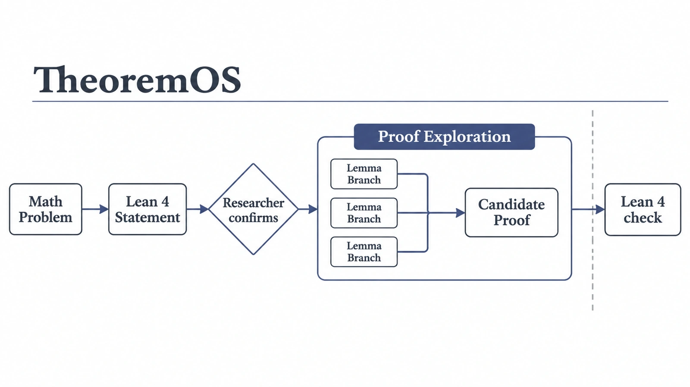

<!-- README_SYNC: source=16ba55670be597f22058a32c185727a047f63791; updated=2026-11-18 -->

简体中文 · <a href="./README.md" lang="en">English</a>

# TheoremOS

把数学问题带进 TheoremOS 在线工作台，你可以核对生成的 Lean 4 陈述、给证明路线提意见。系统会检索已有结果、探索引理，并将完整候选证明交给独立的 Lean 环境检查。

可以给[仓库点 Star](https://github.com/HuggingMath/TheoremOS)，方便回看证明档案和复核包。

**证明档案：** [简体中文](https://theoremos.top/archive.html) · [English](https://theoremos.top/en/archive.html)

**云端工作台：** [申请研究内测](https://github.com/HuggingMath/TheoremOS/issues/new?template=early-access.yml) · [登录](https://app.theoremos.top/) · [访问说明](./docs/ACCESS.md)

本仓库公开[官网](https://theoremos.top/)（[English](https://theoremos.top/en/)）、证明档案和本地复核材料。工作台在线使用，运行时源码和 CLI 安装包未公开。

## 开始使用

1. **先看档案，无须账号。** 打开上面的证明档案，查看题面、Lean 源码、已记录的尝试和检查报告。[平面 Anderson 算子谱案例（中文）](./docs/CASE-STUDY.zh-CN.md)（[EN](./docs/CASE-STUDY.md)）展示了怎样读这些材料。
2. **在网页上开始研究。** 申请邮箱白名单，审核后用邮箱验证码登录。内测期间平台免费，用户需自备受支持的 Responses API 模型密钥，并向模型服务商支付调用费用。建议运行前设置时间和 token 预算。操作见[首次使用教程（中文）](./docs/GETTING-STARTED.zh-CN.md)（[EN](./docs/GETTING-STARTED.md)）。
3. **在本地复核证明。** 不需要 TheoremOS 账号或模型密钥。可以从[Lean 复核指引（中文）](./docs/VERIFY.zh-CN.md)（[EN](./docs/VERIFY.md)）的入门示例开始，或使用包含固定评测环境、证明与对照检查步骤的 [Dimitrov 复核包（中文）](./proof-kits/dimitrov/README.zh-CN.md)（[EN](./proof-kits/dimitrov/README.md)）。

工作台截图：[简体中文](./assets/workbench-desktop.png) · [English](./assets/workbench-desktop-en.png)。Lean 回放（[中文](./assets/proof-replay-zh.gif) · [EN](./assets/proof-replay-en.gif)）用一个小例子展示提交候选证明、修正和核验的过程。

## 怎样组织证明工作

- **先核对题意。** 提交自然语言、TeX 或单个 Lean 文件，得到可编译的陈述；独立审查会将陈述与原题比较。编译检查语法和类型，题意是否一致仍需研究者确认。
- **先验证路线，再补齐引理。** 暂时假设候选引理成立，检查它们能否推出主目标。分别证明引理后合并，去掉临时假设并核查完整证明。
- **查看尝试并复用结论。** 工作台显示已保存的尝试和编译反馈，研究者可以调整计划。已验证的引理可以复用，并在新题目的 Lean 环境里再次检查。
- **通过研究合作做定制实验。** 多文件项目及执行、核验、调度、上下文和职责策略的对照实验，可联系团队商议 CLI 研究使用方式。见[能力与开放范围（中文）](./docs/CAPABILITIES.zh-CN.md)（[EN](./docs/CAPABILITIES.md)）。

## 证明证据

[档案目录](./data/catalog.json)包含 10 份有 Lean-Eval 官方通过记录的证明、18 条经本地 Lean 和原题比较器复核的 OpenAI Math 记录，以及 1 条未完成记录。OpenAI Math 部分没有 OpenAI 官方确认，有些条目对应辅助结论或条件命题。[评测数据与口径（中文）](./docs/EVALUATION.zh-CN.md)（[EN](./docs/EVALUATION.md)）介绍较早一次归档快照的选定运行；不能据此计算全系统的成功率或成本。

下方按来源列出证明和各自的检查依据。

### Lean-Eval：10 份官方通过的证明

<b>查看全部 10 份通过官方评测的证明</b>

| 证明 | 领域 | 官方结果 |
| --- | --- | --- |
| [群环中的非平凡单位：单位猜想反例](accepted/annals_unit_conjecture/) | 代数 | [#1246 · 通过](https://github.com/leanprover/lean-eval-submissions/issues/1246#issuecomment-5380977645) |
| [Rademacher 型与 Enflo 型的一致性](accepted/annals_rademacher_enflo_type/) | 泛函分析 | [#2115 · 通过](https://github.com/leanprover/lean-eval-submissions/issues/2115#issuecomment-6161355838) |
| [固定夹角的等角线](accepted/annals_equiangular_lines_fixed_angle/) | 离散几何 | [#2135 · 通过](https://github.com/leanprover/lean-eval-submissions/issues/2135#issuecomment-6186332699) |
| [分数期望阈值](accepted/annals_fractional_expectation_thresholds/) | 概率组合 | [#2141 · 通过](https://github.com/leanprover/lean-eval-submissions/issues/2141#issuecomment-6197783762) |
| [Dimitrov 的代数整数 house 下界](accepted/dimitrov/) | 代数数论 | [#2143 · 通过](https://github.com/leanprover/lean-eval-submissions/issues/2143#issuecomment-6215093969) |
| [Hopf–Rinow 定理](accepted/hopf_rinow/) | 黎曼几何 | [#2143 · 通过](https://github.com/leanprover/lean-eval-submissions/issues/2143#issuecomment-6215093969) |
| [向日葵引理的改进界](submitted/annals_improved_bounds_sunflower_lemma/) | 组合数学 | [#2144 · 通过](https://github.com/leanprover/lean-eval-submissions/issues/2144#issuecomment-6222767100) |
| [Lorentzian 多项式的闭包刻画](submitted/annals_lorentzian_polynomials/) | 代数组合 | [#2144 · 通过](https://github.com/leanprover/lean-eval-submissions/issues/2144#issuecomment-6222767100) |
| [纸带 Möbius 环的长宽比下界](submitted/annals_optimal_moebius/) | 几何 | [#2144 · 通过](https://github.com/leanprover/lean-eval-submissions/issues/2144#issuecomment-6222767100) |
| [代数整数：λ_SSS 的上界](submitted/annals_algebraic_integers/) | 代数数论 | [#2144 · 通过](https://github.com/leanprover/lean-eval-submissions/issues/2144#issuecomment-6222767100) |

模型与来源信息见 [accepted.json](accepted/accepted.json) 和 [submitted.json](submitted/submitted.json)。最后四项在[提交 #2144](https://github.com/leanprover/lean-eval-submissions/issues/2144#issuecomment-6222767100) 中一同通过，源码保存在 `submitted/`。

### OpenAI Math：18 条证明记录

下表链接到已公开的本地检查报告和研究记录。其中文字标注的“曲面全部接缝”条目对应所列曲面表示下的辅助结论。

<b>查看全部 18 条记录的题目、证明源码、检查结果与完整研究过程</b>

| 题目 | 领域 | 题面与证明 | 检查结果与研究过程 |
| --- | --- | --- | --- |
| 三状态模型在正则树与泊松树上的超临界重构 | 概率论 | [题面](data/proofs/openai_three_state_supercritical/Challenge.lean) · [证明](data/proofs/openai_three_state_supercritical/Submission.lean) | [检查结果](data/proofs/openai_three_state_supercritical/verification.json) · [研究过程](data/proofs/openai_three_state_supercritical/process.json) |
| 三角展开下匹配多面体的面对应 | 组合优化 | [题面](data/proofs/openai_triangle_face/Challenge.lean) · [证明](data/proofs/openai_triangle_face/Submission.lean) | [检查结果](data/proofs/openai_triangle_face/verification.json) · [研究过程](data/proofs/openai_triangle_face/process.json) |
| Koebe 映射及逆映射的端点不可积性 | 复分析 | [题面](data/proofs/openai_brennan_sharp/Challenge.lean) · [证明](data/proofs/openai_brennan_sharp/Submission.lean) | [检查结果](data/proofs/openai_brennan_sharp/verification.json) · [研究过程](data/proofs/openai_brennan_sharp/process.json) |
| 数值域几何与有限维压缩的辅助结果 | 泛函分析 | [题面](data/proofs/openai_hilbert_crouzeix/Challenge.lean) · [证明](data/proofs/openai_hilbert_crouzeix/Submission.lean) | [检查结果](data/proofs/openai_hilbert_crouzeix/verification.json) · [研究过程](data/proofs/openai_hilbert_crouzeix/process.json) |
| 平面 Anderson 算子的几乎必然谱 | 随机算子 | [题面](data/proofs/openai_planar_anderson_spectrum/Challenge.lean) · [证明](data/proofs/openai_planar_anderson_spectrum/Submission.lean) | [检查结果](data/proofs/openai_planar_anderson_spectrum/verification.json) · [研究过程](data/proofs/openai_planar_anderson_spectrum/process.json) |
| Ising 感知器变分值的有限性 | 概率与统计物理 | [题面](data/proofs/openai_ising_finiteness/Challenge.lean) · [证明](data/proofs/openai_ising_finiteness/Submission.lean) | [检查结果](data/proofs/openai_ising_finiteness/verification.json) · [研究过程](data/proofs/openai_ising_finiteness/process.json) |
| 欧拉函数伴随定理：无种子零值情形 | 数论 | [题面](data/proofs/openai_totient_companion_zero/Challenge.lean) · [证明](data/proofs/openai_totient_companion_zero/Submission.lean) | [检查结果](data/proofs/openai_totient_companion_zero/verification.json) · [研究过程](data/proofs/openai_totient_companion_zero/process.json) |
| 归一化 Cartier 坐标回缩族的紧致性 | 代数几何与拓扑 | [题面](data/proofs/openai_cartier_chart_compactness_support/Challenge.lean) · [证明](data/proofs/openai_cartier_chart_compactness_support/Submission.lean) | [检查结果](data/proofs/openai_cartier_chart_compactness_support/verification.json) · [研究过程](data/proofs/openai_cartier_chart_compactness_support/process.json) |
| 有限同余格的彩色图判据 | 泛代数与格论 | [题面](data/proofs/openai_finite_congruence_graph/Challenge.lean) · [证明](data/proofs/openai_finite_congruence_graph/Submission.lean) | [检查结果](data/proofs/openai_finite_congruence_graph/verification.json) · [研究过程](data/proofs/openai_finite_congruence_graph/process.json) |
| 蜂窝格自由能极限的存在性 | 概率与统计物理 | [题面](data/proofs/openai_honeycomb_free_energy/Challenge.lean) · [证明](data/proofs/openai_honeycomb_free_energy/Submission.lean) | [检查结果](data/proofs/openai_honeycomb_free_energy/verification.json) · [研究过程](data/proofs/openai_honeycomb_free_energy/process.json) |
| 欧氏平面的七色着色 | 离散几何 | [题面](data/proofs/openai_plane_coloring/Challenge.lean) · [证明](data/proofs/openai_plane_coloring/Submission.lean) | [检查结果](data/proofs/openai_plane_coloring/verification.json) · [研究过程](data/proofs/openai_plane_coloring/process.json) |
| Snaky 的 35 步合法获胜策略 | 组合博弈 | [题面](data/proofs/openai_snaky_conditional/Challenge.lean) · [证明](data/proofs/openai_snaky_conditional/Submission.lean) | [检查结果](data/proofs/openai_snaky_conditional/verification.json) · [研究过程](data/proofs/openai_snaky_conditional/process.json) |
| Snaky 证书核验 | 组合博弈 | [题面](data/proofs/openai_snaky_certificate/Challenge.lean) · [证明](data/proofs/openai_snaky_certificate/Submission.lean) | [检查结果](data/proofs/openai_snaky_certificate/verification.json) · [研究过程](data/proofs/openai_snaky_certificate/process.json) |
| 六阶 Hadamard 行比值的立方纤维消去 | 线性代数 | [题面](data/proofs/openai_hadamard_cube_fiber/Challenge.lean) · [证明](data/proofs/openai_hadamard_cube_fiber/Submission.lean) | [检查结果](data/proofs/openai_hadamard_cube_fiber/verification.json) · [研究过程](data/proofs/openai_hadamard_cube_fiber/process.json) |
| 三维完备诺特正规局部复代数 | 交换代数 | [题面](data/proofs/openai_surface_cone_candidate_support/Challenge.lean) · [证明](data/proofs/openai_surface_cone_candidate_support/Submission.lean) | [检查结果](data/proofs/openai_surface_cone_candidate_support/verification.json) · [研究过程](data/proofs/openai_surface_cone_candidate_support/process.json) |
| Truffet 优化程序的有限反例 | 热带优化 | [题面](data/proofs/openai_truffet_counterexample/Challenge.lean) · [证明](data/proofs/openai_truffet_counterexample/Submission.lean) | [检查结果](data/proofs/openai_truffet_counterexample/verification.json) · [研究过程](data/proofs/openai_truffet_counterexample/process.json) |
| 三状态树信道的超临界重构 | 概率论 | [题面](data/proofs/openai_three_state_tree_clauses/Challenge.lean) · [证明](data/proofs/openai_three_state_tree_clauses/Submission.lean) | [检查结果](data/proofs/openai_three_state_tree_clauses/verification.json) · [研究过程](data/proofs/openai_three_state_tree_clauses/process.json) |
| 曲面全部接缝标记迹值的辅助结论 | 代数几何 | [题面](data/proofs/openai_character_varieties_all_seams_support/Challenge.lean) · [证明](data/proofs/openai_character_varieties_all_seams_support/Submission.lean) | [检查结果](data/proofs/openai_character_varieties_all_seams_support/verification.json) · [研究过程](data/proofs/openai_character_varieties_all_seams_support/process.json) |

## 仓库内容与引用

| 路径 | 可以查到什么 |
| --- | --- |
| [accepted/](./accepted/) 与 [submitted/](./submitted/) | Lean-Eval 证明包及官方结果来源 |
| [data/proofs/](./data/proofs/) | OpenAI Math 题面、证明文件、本地检查报告和已保存的过程记录 |
| [in-progress/](./in-progress/) | 早期草稿，部分仍含未闭合的 `sorry` |
| [proof-kits/](./proof-kits/) 与 [examples/](./examples/) | 独立评测复核包及简短的 Lean 示例 |
| [docs/](./docs/) 与 [CHANGELOG.md](./CHANGELOG.md) | 访问、复核、评测及版本说明 |

[LICENSE](./LICENSE) 保留项目自有公开材料的权利。归档证明和第三方材料沿用各自的许可，见[公开材料、复用与引用](./docs/PUBLIC-MATERIALS.md)。引用项目请用 [CITATION.cff](./CITATION.cff)，引用具体证明时也请注明该证明的原始来源。

需要多文件 Lean 项目、自定义工具链或 CLI 对照实验，可以通过[访问说明](./docs/ACCESS.md)中的方式联系团队。欢迎[提交 Issue](https://github.com/HuggingMath/TheoremOS/issues/new/choose)纠正档案或反馈问题，也可以[点 Star](https://github.com/HuggingMath/TheoremOS)收藏复核资料。
