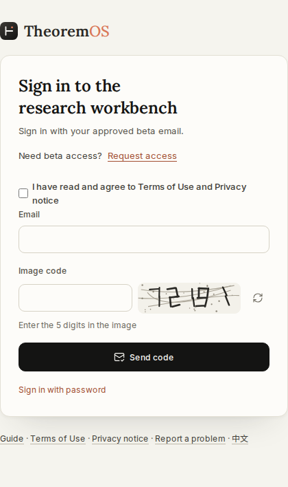
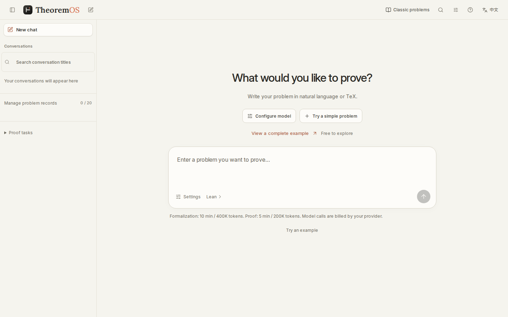
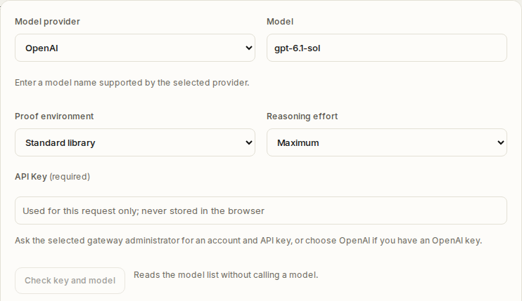
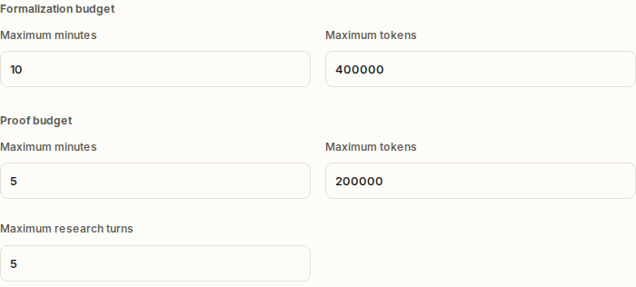
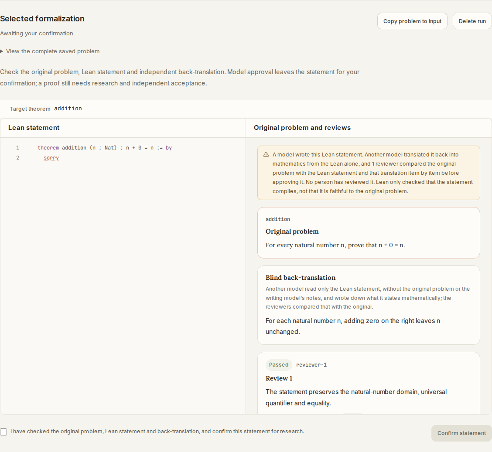
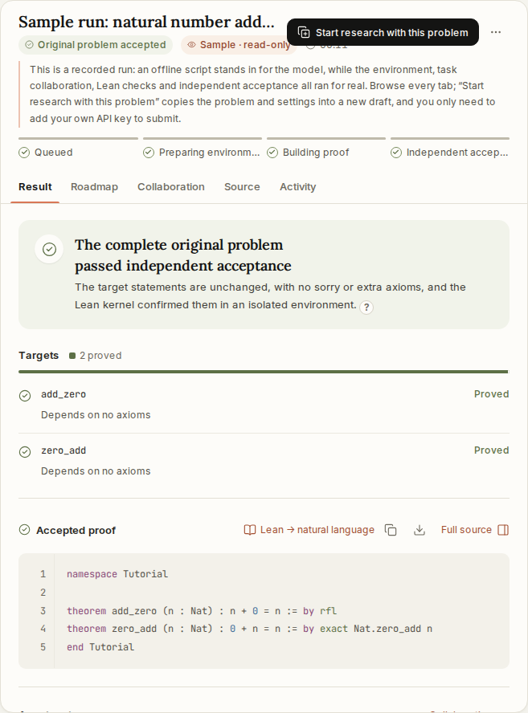
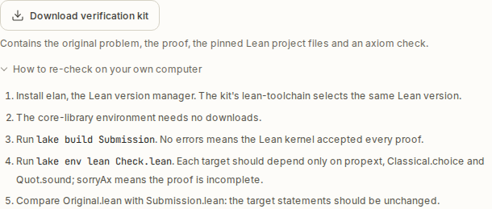

# Getting Started with TheoremOS

[简体中文](GETTING-STARTED.zh-CN.md) · [Back to README](../README.md)

TheoremOS is a cloud-based AI mathematical research system built to work alongside mathematicians. It accepts natural language, $`\TeX`$, and Lean 4 inputs and runs entirely in the browser—no local Lean toolchain or Docker setup is required. The platform itself is free to use; you supply your own model API key and pay the model provider directly for your API usage.

This tutorial walks through the current workbench interface using a simple natural-number proposition ($`n + 0 = n`$) to illustrate login, model and two-stage budget settings, statement review, and artifact export. The result and download screenshots at the end are taken from a built-in read-only example on the workbench to illustrate the interface layout.

## 1. Requesting Access and Signing In

The cloud beta currently operates on an email allowlist. To request access, submit a brief public description of your intended research use via the [GitHub Early Access form](https://github.com/LikC1606/TheoremOS/issues/new?template=early-access.yml). Do not include any API keys or private credentials in the public issue; your login email will be confirmed privately following review (see [`ACCESS.md`](ACCESS.md) for details).

Once your email is allowlisted, open [https://app.theoremos.top/](https://app.theoremos.top/). In the first step, enter your allowlisted email address, complete the 5-digit graphic captcha, and request a verification code. In the second step, enter the 6-digit verification code sent to your inbox to sign in (accepting the terms of service when prompted).

*Figure 1: Step one of the sign-in screen, showing the email input, 5-digit graphic captcha, and verification code request button.*

## 2. Configuring Your Model Provider and Two-Stage Budgets

After signing in, you will arrive at the main workbench. The main prompt box accepts natural language and $`\TeX`$ problem statements; if you already have Lean 4 source code, click the `Lean` entry button below the prompt box. Before submitting a problem, click **"Configure model"** to expand the settings section.

*Figure 2: The TheoremOS workbench home screen. The main input box accepts natural language and $`\TeX`$, with dedicated buttons below for Lean source input and "Configure model".*

In the upper portion of the settings section, configure your model and reasoning effort:

1. **Model Provider, Model, and API Key**: Select a **"Model provider"** from the platform's deployed dropdown list, then enter the **"Model"** name and your **"API Key"**. There is no custom Base URL field; your chosen provider and model must support the Responses API, and your key must match the selected provider. You can click **"Check key and model"** to verify credentials—note that this button only queries the provider's model list without invoking an inference model, so passing the list check does not guarantee that Responses API inference calls have been live-tested.
2. **Mathematics Environment and Reasoning Effort**: New tasks use the unified **TheoremOS mathematics environment** with Lean 4.33.0, Mathlib and 53 TheoremOS library modules. Set the desired **"Reasoning effort"**. Frozen tasks and historical evidence retain their original environment.

Newly entered keys are temporary by default and clear on refresh. If account key storage is enabled, explicitly choose **"Save to my account"** in natural-language Settings. The same checkbox in Lean Model connection starts unchecked; only selecting it before submission saves or replaces an account key. Saved keys are encrypted, only their last four characters are shown, and you can delete them at any time.

*Figure 3: The recorded settings view shows the model connection and reasoning controls. New tasks use the unified TheoremOS mathematics environment.*

Next, configure the **two-stage budgets** in the lower portion of the settings section. TheoremOS separates formalization from proof search, allowing you to limit each stage independently. New tasks default to unlimited budgets; set limits before sending if needed:

| Budget Stage | Scope | Current Default Limit |
| :--- | :--- | :--- |
| **Formalization budget** | Controls generating and reviewing the formal Lean 4 statement from natural language or $`\TeX`$ | Unlimited time and tokens |
| **Proof budget** | Controls subsequent lemma decomposition, proof search, and Lean kernel checks | Unlimited time, tokens and rounds |

> **Understanding Budgets and Billing**: These token and time settings act as usage and time limits rather than fixed costs or monetary caps. The system halts subsequent calls based on usage already reported by the provider, meaning an in-flight request may exceed the configured token number upon completion. You may also set spending limits in your model provider's billing settings (depending on the features offered by your provider).

*Figure 4: The recorded view shows separate formalization and proof budget controls. New tasks default to unlimited budgets; values entered before sending set limits.*

## 3. Submitting a Problem and Reviewing the Formal Statement

To familiarize yourself with the workflow, submit the following test prompt in the main input box using the unified **TheoremOS mathematics environment** (submitting immediately invokes the model and consumes API quota):

> For every natural number n, prove that n + 0 = n.

When working on actual research problems, state all definitions, hypotheses, ambient spaces, and conclusions explicitly, and cite relevant references where helpful.

**The home page defaults to "Work together"**. After submission, the system generates the Lean statement, independently back-translates and reviews it, then waits for you to check its meaning in the conversation. Choose **"Confirm statement and draft plan"** to have 2 Agents draft the initial research plan. Check its tasks and dependencies, request changes if needed, then choose **"Approve plan and start proving"**. You can inspect **"Problem / Lean"** and **"Formalization review"** during or after a run.

Drafting a plan and revising it after guidance consume the proof budget. While the system only waits for your review or approval, the proof timer pauses and no model is called. Approval continues the same run; closing and reopening the page needs no restart. If you select **"Run automatically"** before sending, 1 Agent starts proving after model review without waiting for statement confirmation or plan approval.

Pay close attention to types (e.g., $`\mathbb{N}`$ vs. $`\mathbb{Z}`$), hypotheses, quantifier order, and conclusions. Automated formalization review is an aid and cannot guarantee that a natural-language question and a formal proposition are completely equivalent; what the Lean check ultimately certifies is the proof of the formal Lean statement.

### Optional Workflow: Formalize Separately, Then Import a Research Draft

"Work together" on the home page already includes statement confirmation and initial plan approval. To generate and confirm a statement separately, use the standalone **Statement Formalization page** at [https://app.theoremos.top/formalize.html](https://app.theoremos.top/formalize.html).

1. **Standalone Configuration**: This page **does not inherit model or budget settings from the home page**. It uses the platform default model and the unified TheoremOS mathematics environment, with unlimited formalization time and tokens by default. Set your reasoning effort and any budget limits, enter your API key, and click **"Generate Lean statement"**.
2. **Review and Confirm**: Compare your original prompt against the generated Lean code and independent back-translation. Check the confirmation box to enable and click **"Confirm statement"**, then click **"Use in research draft"** in the next step.
3. **Launch Proof Research**: Clicking "Use in research draft" **only imports the statement into a workbench draft; it does not start proof search automatically**, nor does it transfer a one-time API key from the standalone formalization page. In the workbench's **"Research settings"**, configure your proof model, API key, and proof budget, then click **"Start research"**.

*Figure 5: The statement review area on the standalone formalization page (`formalize.html`), using a fixed small example to illustrate the interface (checking the confirmation box enables "Confirm statement" before importing into a research draft).*

## 4. Inspecting the Acceptance Report and Downloading Artifacts

Once a run finishes—or when browsing a built-in read-only example from the sidebar—click **"View acceptance report"** in the results area to inspect the final verification summary.

For problems originating from natural language, **if the proof succeeds**, the interface displays **"Lean statement proved"** and separately indicates whether the statement was manually confirmed. Keep in mind that compiling without syntax errors, having candidate sketches, stopping normally, or exhausting the budget cannot be equated with a verified proof; **always rely on the independent Lean kernel check of the complete problem**. Partial progress and failed attempts are also retained for inspection.

*Figure 6: Inspecting the verified proof and acceptance report view (screenshot from a built-in read-only workbench example).*

TheoremOS provides three download options depending on what you need to archive or audit:

* **Download verification kit (ZIP)**: Click **"Download verification kit"** to download a ZIP archive containing `Original.lean` (the problem template), `Submission.lean` (the final proof), pinned project configuration files, verification scripts, and reproduction instructions. When `Original.lean` contains a template placeholder `sorry`, read `Submission.lean` for the complete proof. Reproducing the check locally requires fetching or installing the Lean environment dependencies according to the included instructions (see [`VERIFY.md`](VERIFY.md)). The verification kit never contains your model API key.
* **Individual Lean Source & Report**: Direct download links for the standalone Lean source file and result report are available in the result area.
* **Run Archive JSON**: The task menu downloads the full archive saved by the server by default, including events, observations, Agent actions, source versions, checks and commands, with a coverage statement. Storage limits and records absent from older versions are reported explicitly; "full" refers to saved contents. Importing an archive extracts the original problem and settings into a new draft rather than restoring the historical server run.

**"Continue from this version"** in the roadmap or source view starts a new run from that exact saved source and digest while retaining the frozen original problem. The new run still needs Lean checks and independent acceptance. **"Continue proof"**, shown when formalization finished but the proof queue could not accept it, reuses the existing statement without formalizing again.

*Figure 7: The "Download verification kit" entry and local verification instructions (screenshot from a built-in read-only workbench example).*

## 5. Common Blockers and Troubleshooting

* **Email not authorized**: Submit an application via the [Early Access form](https://github.com/LikC1606/TheoremOS/issues/new?template=early-access.yml) and wait for private email confirmation before signing in.
* **Key or model check/call fails**: Verify that your API key matches the exact **"Model provider"** selected in the dropdown and that the specified model supports the Responses API.
* **Budget limit reached**: Inspect the current progress and intermediate lemmas before deciding whether to continue research with a higher budget or adjust your mathematical direction.
* **The formal statement changes the intended meaning**: Edit assumptions or types at the statement confirmation step in "Work together", then generate and review the statement again. The standalone [`formalize.html`](https://app.theoremos.top/formalize.html) page is also available.

---
To see how TheoremOS handles a research-level formalization in mathematical physics, read the [Planar Anderson Operator Case Study](CASE-STUDY.md). For research collaboration inquiries, contact `liuzhenhao@westlake.edu.cn`.
