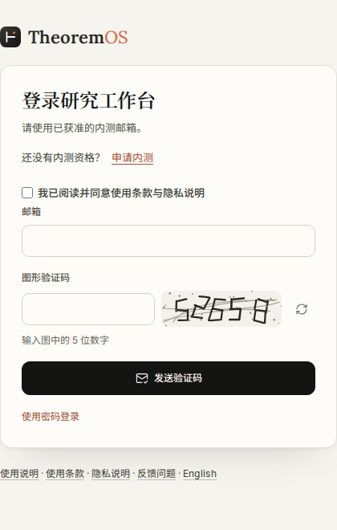
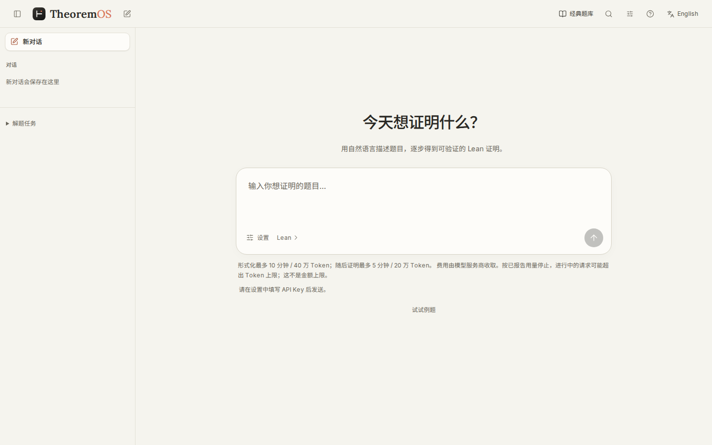
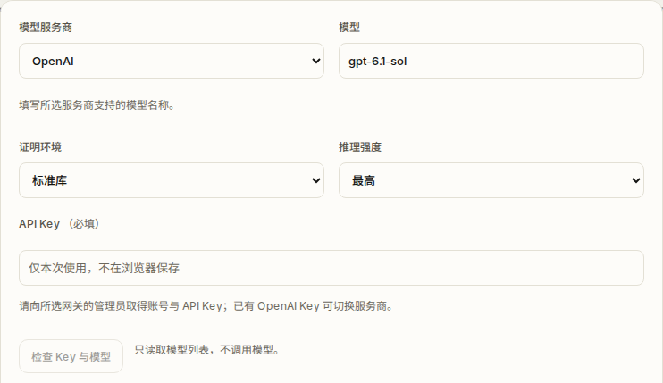
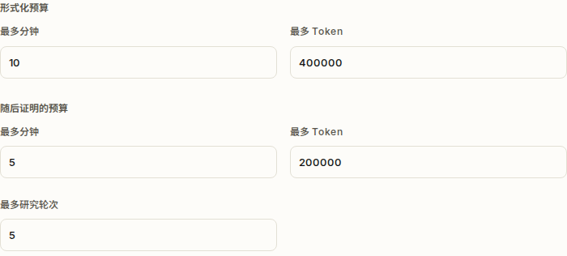
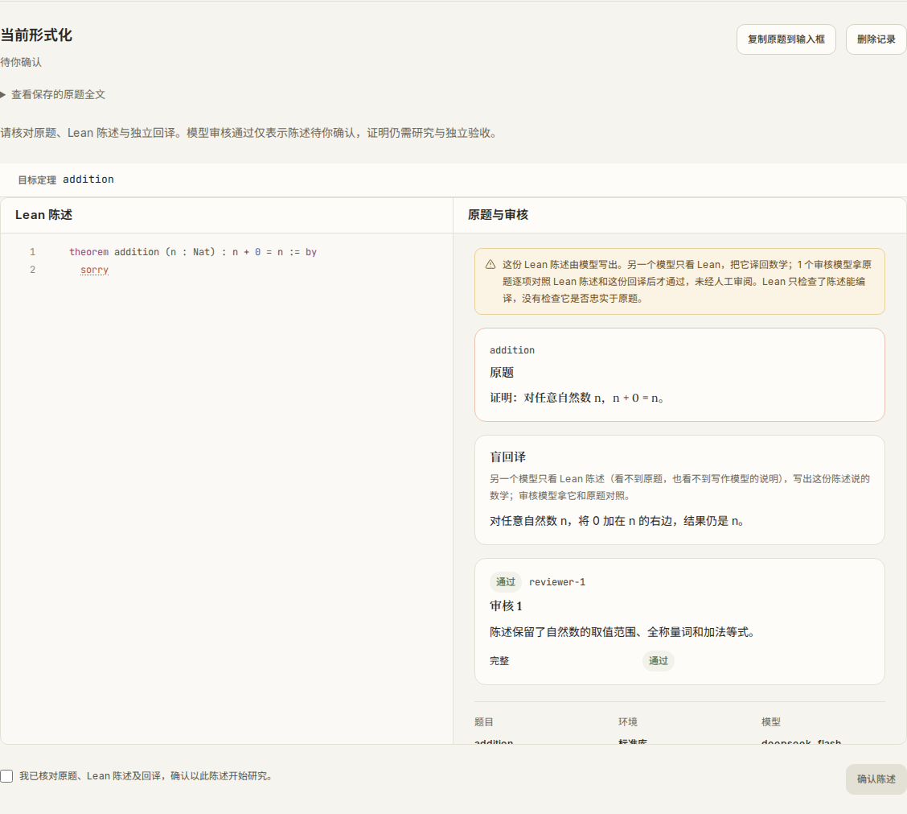
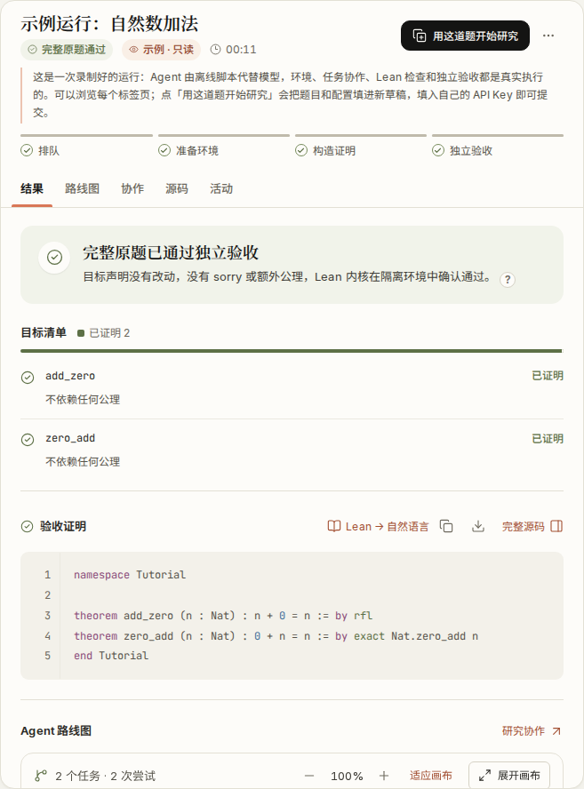
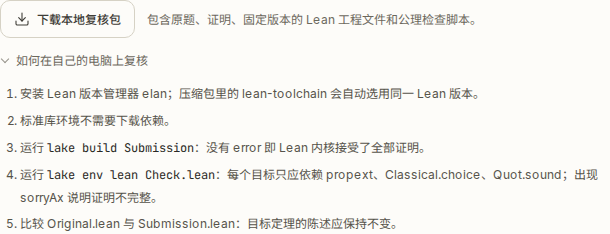

# TheoremOS 首次使用图文教程

[English](GETTING-STARTED.md) · [返回中文主页](../README.zh-CN.md)

TheoremOS 是面向数学研究者的云端协作系统，支持自然语言、$`\TeX`$ 与 Lean 4 输入，无需在本地安装 Lean 工具链或 Docker 环境。研究平台本身免费使用；用户只需接入自己的大模型 API Key，由对应的模型服务商按实际调用计费。

本教程使用简单的自然数命题 $`n + 0 = n`$ 演示新版工作台的完整操作流程：从内测登录、模型与双阶段预算设置、题意检查，到结果查看与复核包下载。文末的结果与下载截图取自工作台内置只读示例，仅用于说明界面布局与功能位置。

## 1. 申请访问与登录工作台

当前云端内测采用邮箱白名单机制。首次使用前，请通过 [GitHub Early Access 申请表单](https://github.com/LikC1606/TheoremOS/issues/new?template=early-access.yml)提交公开的研究用途说明（切勿在公开 Issue 中填写任何 API Key 或敏感信息；具体登录邮箱将在审核回复后私下确认，详见 [`ACCESS.md`](ACCESS.md)）。

邮箱加入白名单后，访问云端工作台 [https://app.theoremos.top/](https://app.theoremos.top/)。第一步，在登录界面输入白名单邮箱并完成 5 位数字图形验证码，点击发送验证码；第二步，查收邮件并在随后出现的输入框中填入 6 位邮箱验证码完成登录（首次登录或协议更新时需勾选同意服务条款）。

*图 1：登录第一步界面，填写白名单邮箱与 5 位数字图形验证码以获取邮箱验证码。*

## 2. 配置模型服务商与双阶段预算

登录后进入新版研究工作台首页。主输入框支持直接填写自然语言或 $`\TeX`$ 数学问题；若已有现成的 Lean 4 源码，可点击输入区下方的 `Lean` 入口提交。在发起研究前，请点击 **“配置模型”** 展开设置区。

*图 2：TheoremOS 工作台首页。主输入框接收自然语言与 $`\TeX`$ 题目，下方提供 Lean 源码入口与“配置模型”入口。*

在展开的设置区上半部分，首先完成模型与环境配置：

1. **模型服务商、模型与 API Key**：从平台已部署的下拉列表中选择 **“模型服务商”**，填写对应的 **“模型”** 名称与您的 **“API Key”**。界面不提供自定义 Base URL 输入框，所选服务商与模型必须支持 Responses API，且 Key 需与所选服务商匹配。可点击 **“检查 Key 与模型”** 验证连通性——注意该按钮仅通过读取模型列表测试凭证是否可用，不会发起推理模型调用，通过列表检查不等于实际 Responses 推理调用已实测通过。
2. **证明环境与推理强度**：根据题目需要选择 **“证明环境”**（`标准库` 或 `Mathlib`）以及模型的 **“推理强度”**。

*图 3：在设置区选择模型服务商、证明环境（标准库 / Mathlib）、推理强度，并填入与服务商匹配的 API Key。*

接着在设置区下半部分配置**双阶段预算**。系统将形式化与证明拆分为两个独立计量的阶段，下表为当前界面默认值（具体数值以工作台界面显示为准）：

| 预算阶段 | 作用范围 | 当前默认上限 |
| :--- | :--- | :--- |
| **形式化预算** | 控制将自然语言/$`\TeX`$ 转化为 Lean 4 陈述并进行初步语法与语义检查 | 10 分钟 / 400,000 Token |
| **随后证明的预算** | 控制陈述生成后的引理分解、证明搜索与 Lean 内核交互 | 5 分钟 / 200,000 Token / 5 轮 |

> **关于预算与计费的说明**：上述 Token 与时间上限是工作台的任务停止限制，而非固定花费或金额上限。系统依据服务商已报告的累计用量停止后续调用，因此正在进行中的请求在完成时可能超出设定的 Token 数值。您也可以在模型服务商后台设置账户消费限额（具体限额功能以各服务商支持为准）。

*图 4：分别配置“形式化预算”（10 分钟 / 400,000 Token）与“随后证明的预算”（5 分钟 / 200,000 Token / 5 轮）。*

## 3. 输入题目与检查形式化题意

首次熟悉界面时，可将证明环境设为 **“标准库”**，在首页主输入框中填入以下测试题并发送（发送后即开始调用模型并消耗 API 额度）：

> 证明：对任意自然数 n，n + 0 = n。

在实际科研问题中，建议尽可能完整地写出背景定义、全部假设条件、目标结论以及相关文献来源，以减少形式化歧义。

**首页默认工作流的行为**：在首页直接提交题目后，系统会先生成并审核 Lean 陈述，随后**自动进入证明阶段**，期间不会暂停等待人工点击确认。在运行过程中或结束后，您可以随时打开任务视图中的 **“原题 / Lean”** 与 **“形式化审核”** 查看对应关系。

请重点核对：核心定义、类型域（如自然数 $`\mathbb{N}`$ 与整数 $`\mathbb{Z}`$ 的区分）、量词顺序以及前提假设是否准确。系统的形式化审核仅作为辅助参考，不能保证自然语言与形式命题完全等价；最终 Lean 内核检查通过的始终是该正式 Lean 陈述的证明。

### 可选分支：先人工确认题面，再开始证明

如果您希望在消耗“随后证明的预算”之前亲自确认 Lean 题面，请使用独立的**题面形式化页面**：[https://app.theoremos.top/formalize.html](https://app.theoremos.top/formalize.html)。

1. **独立配置与生成**：该页面**不继承首页的模型与预算设置**，默认使用页面显示的平台默认模型与形式化预算（当前为 10 分钟 / 400,000 Token）。在该页面选择证明环境与推理强度，填入 API Key，输入题目后点击 **“生成 Lean 陈述”**。
2. **核对与确认**：生成完成后，对照原题、Lean 代码与独立回译说明。确认无误后，勾选确认框以启用并点击 **“确认陈述”**，随后点击下一步出现的 **“带入研究草稿”**。
3. **启动证明**：点击“带入研究草稿”**只会将题面导入工作台草稿，不会自动开始证明**，且在独立形式化页填写的一次性 Key 不会自动转交。此时需在工作台的 **“研究配置”** 中重新设定证明模型、API Key 与解题预算，最后点击 **“开始研究”**。

*图 5：独立形式化页面（`formalize.html`）的题面确认区域（以固定小例题说明界面操作；勾选确认框后即可点击“确认陈述”并带入研究草稿）。*

## 4. 查看验收报告与下载复核资料

任务运行结束后（或直接点击左侧列表查看工作台内置的只读示例），可在结果区点击 **“查看验收报告”** 审阅最终核查结论。

对于由自然语言生成的题目，**若证明通过**，界面会显示 **“Lean 陈述证明通过”**，并另行标明该题面是否经过人工确认。请注意区分中间状态与最终结论：仅通过语法编译、存在候选草稿、任务停止或预算耗尽，都不能等同于最终证明通过；**一切以完整题目通过独立 Lean 内核检查的结果为准**。即便研究仅取得部分进展或中途失败，相关记录也会保留供查看。

*图 6：查看结果与验证证明界面（截图来自工作台内置只读示例，非现场求解演示）。*

工作台提供三种不同粒度的下载入口，方便归档与本地复核：

* **本地复核包（ZIP）**：点击 **“本地复核包”** 按钮，下载包含 `Original.lean`（原题模板）、`Submission.lean`（最终提交代码）、固定版本工程配置、检查脚本及复核说明的 ZIP 压缩包。若 `Original.lean` 含有模板占位 `sorry`，请阅读最终 `Submission.lean` 中的完整证明。本地复核时需按说明准备或安装相应的 Lean 环境依赖（详见 [`VERIFY.zh-CN.md`](VERIFY.zh-CN.md)）。本地复核包本身不包含任何模型 API Key。
* **单文件源码与报告**：结果区同时提供单独的 Lean 源码文件与结果报告下载。
* **运行档案 JSON**：在任务菜单中可下载完整的运行档案 JSON，内含子任务分解与各轮探索记录。

*图 7：本地复核包下载入口与复核说明区域（截图来自工作台内置只读示例）。*

## 5. 常见阻塞与排查

* **提示邮箱未开通权限**：请先通过 [Early Access 表单](https://github.com/LikC1606/TheoremOS/issues/new?template=early-access.yml)提交申请，待审核回复并私下确认邮箱加入白名单后再登录。
* **Key 或模型检查/调用失败**：请确认所填 API Key 与下拉所选的“模型服务商”严格对应，且所填模型名称在该服务商处支持 Responses API。
* **预算达到上限停止**：检查当前已完成的中间引理与探索进展，再决定是调高预算继续研究还是调整证明方向。
* **生成的形式化题意偏离原意**：修正原题描述中的隐含假设或类型定义，或前往 [`formalize.html`](https://app.theoremos.top/formalize.html) 确认无误的 Lean 陈述后再开展后续研究。

---
想了解系统在真实科研问题上的表现，请阅读[平面 Anderson 算子谱案例研究](CASE-STUDY.zh-CN.md)。如有学术合作意向，欢迎联系 `liuzhenhao@westlake.edu.cn`。
